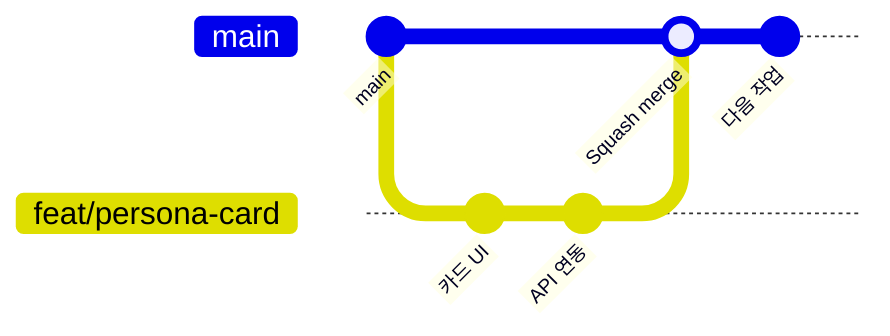

# 협업 가이드

- 룸메궁합 팀의 GitHub 협업 규칙
- 개발 착수 **10/27(화)**, 기능 동결 **11/1(일)**

## 팀과 담당

| 이름 | 역할 | 담당 폴더 | 주요 참고 문서 |
| --- | --- | --- | --- |
| 건한 | PM · 기획 · QA, AI 시뮬레이션 엔진 | `docs/` `engine/` `data/` | [PRD](docs/PRD.md) · [일정](docs/SCHEDULE.md) |
| 동현 | 프론트엔드 | `frontend/` | [API 명세서](docs/API.md) 1~5장 |
| 일준 | 백엔드 | `backend/` | [API 명세서](docs/API.md) 전체 |
| 범찬 | 백엔드 · 데이터 | `backend/` `data/seed/` | [API 명세서](docs/API.md) 전체 |

## 작업 흐름



1. **할 일 확인** — [일정 문서](docs/SCHEDULE.md)의 날짜별 할 일 표 내 당일 담당 칸 확인
2. **브랜치** — `main`에서 `종류/짧은-설명` 형식으로 분기 (예: `feat/persona-card`)
3. **커밋** — 아래 커밋 규칙 준수, 작은 단위로 수시 커밋
4. **PR** — PR 템플릿에 작업 내용 및 확인 방법 기재
5. **리뷰** — 리뷰 짝 1명 승인 후 **Squash and merge**, 브랜치 삭제
6. **`main` 상시 실행 가능 상태 유지** — 오류 코드 병합 금지, 발표회 버전은 `main`에서 직접 실행

## 브랜치 이름

| 접두사 | 용도 | 예 |
| --- | --- | --- |
| `feat/` | 기능 | `feat/simulation-sse` |
| `fix/` | 버그 수정 | `fix/report-score-null` |
| `docs/` | 문서 | `docs/api-review` |
| `chore/` | 설정 · 빌드 · 데이터 | `chore/seed-personas` |

## 커밋 메시지

```text
<종류>[(<영역>)]: <한국어 설명>
```

- 종류: `feat` 기능 · `fix` 버그 · `docs` 문서 · `refactor` 구조 개선 · `test` 테스트 · `chore` 설정·데이터
- 영역은 선택 사항: `frontend` · `backend` · `engine` · `data` · `docs`
- **콜론 뒤 설명은 한국어로 작성한다.** `feat`·`docs` 같은 종류와 선택적 영역만 영문으로 쓴다.
- 예: `docs: 문서 수정`, `feat(frontend): 페르소나 카드 화면 추가`, `fix(backend): 리포트 점수 null 처리`

## 리뷰 짝

| PR 영역 | 리뷰어 | 사유 |
| --- | --- | --- |
| `frontend/` | 범찬 | 흐름 C 화면 공동 담당, API 연동 확인 |
| `backend/` | 일준 ↔ 범찬 상호 | 동일 서버 코드 |
| `engine/` | 일준 | 엔진 연결 담당 |
| `docs/API.md` | 동현 + 백엔드 1명 | 프론트 · 백엔드 간 약속 변경 PR |
| `docs/` `data/` | 건한 | PM |

- 리뷰는 요청 당일 내 처리 (6일 개발 기간 고려, PR 1일 이상 정체 방지)

## API 변경 절차

1. `docs/API.md` 수정 PR 선행 (`docs/` 브랜치)
2. 동현 및 백엔드 1명 승인
3. 코드 변경 진행

## 버그 처리

- 즉시 수정 가능 시 `fix/` 브랜치로 수정
- 담당자 확인 필요 시 GitHub 이슈 버그 템플릿 등록 또는 단톡방에 재현 방법과 함께 공유

## 소통

- **스탠드업** — 10/27 ~ 11/2 매일 10분 (시간은 팀 협의): 전일 작업 · 당일 작업 · 애로 사항
- **애로 사항 30분 내 공유** — 장시간 단독 지체 방지
- 결정 사항은 PR 댓글 또는 문서에 기록

## 비밀 정보 관리

- `.env` 커밋 금지, [`backend/.env.example`](backend/.env.example) 복사 후 사용
- API 키는 건한으로부터 비공개 채널로 수령, PR · 커밋 · 단톡 공지 내 키 기재 금지
- 키 노출 시 즉시 건한에게 보고 및 Console에서 키 폐기

## 실행 방법

- 개발 착수(10/27) 후 각 폴더 README에 정리 예정: [frontend](frontend/README.md) · [backend](backend/README.md) · [engine](engine/README.md)
