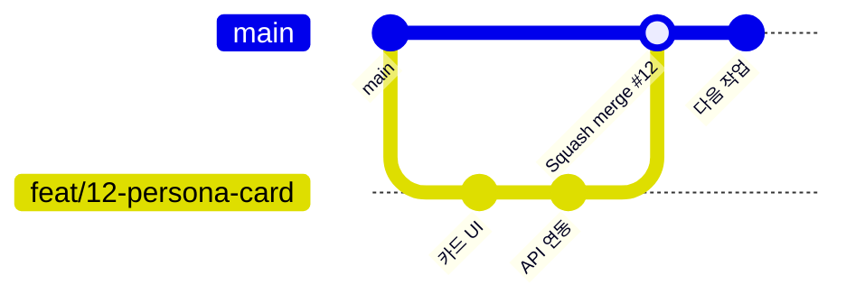

# 협업 가이드

룸메궁합 팀이 GitHub에서 같이 일하는 방법이다. 개발은 **10/27(화)** 에 시작하고 **11/1(일)** 에 기능을 동결한다.

## 팀과 담당

| 이름 | 역할 | 담당 폴더 | 주로 보는 문서 |
| --- | --- | --- | --- |
| 건한 | PM · 기획 · QA, AI 시뮬레이션 엔진 | `docs/` `engine/` `data/` | [PRD](docs/PRD.md) · [일정](docs/SCHEDULE.md) |
| 동현 | 프론트엔드 | `frontend/` | [API 명세서](docs/API.md) 1~5장 |
| 일준 | 백엔드 | `backend/` | [API 명세서](docs/API.md) 전체 |
| 범찬 | 백엔드 · 데이터 | `backend/` `data/seed/` | [API 명세서](docs/API.md) 전체 |

## 작업 흐름



1. **이슈에서 시작** — 모든 작업은 GitHub 이슈로 시작한다. 할 이슈를 골라 Assignee에 본인을 넣는다. 이슈가 없으면 템플릿으로 만든다.
2. **브랜치** — `main`에서 `종류/이슈번호-짧은-설명`으로 분기한다. 예: `feat/12-persona-card`
3. **커밋** — 아래 커밋 규칙대로 작게 자주.
4. **PR** — 본문에 `Closes #12`를 적으면 병합할 때 이슈가 자동으로 닫힌다. PR 템플릿의 체크리스트를 채운다.
5. **리뷰** — 리뷰 짝 1명이 승인하면 **Squash and merge** 후 브랜치를 지운다.
6. **main은 항상 실행 가능** — 깨진 코드는 `main`에 넣지 않는다. 발표회 버전은 `main`에서 바로 실행한다.

## 브랜치 이름

| 접두사 | 쓰임 | 예 |
| --- | --- | --- |
| `feat/` | 기능 | `feat/21-simulation-sse` |
| `fix/` | 버그 수정 | `fix/34-report-score-null` |
| `docs/` | 문서 | `docs/5-api-review` |
| `chore/` | 설정 · 빌드 · 데이터 | `chore/8-seed-personas` |

## 커밋 메시지

```text
<종류>(<영역>): <무엇을 했는지> (#이슈번호)
```

- 종류: `feat` 기능 · `fix` 버그 · `docs` 문서 · `refactor` 구조 개선 · `test` 테스트 · `chore` 설정·데이터
- 영역: `frontend` · `backend` · `engine` · `data` · `docs`
- 예: `feat(frontend): 페르소나 카드 화면 추가 (#12)`, `fix(backend): 리포트 점수 null 처리 (#34)`

## 리뷰 짝

| PR 영역 | 리뷰어 | 이유 |
| --- | --- | --- |
| `frontend/` | 범찬 | 흐름 C 화면을 같이 맡고, API 연동을 확인 |
| `backend/` | 일준 ↔ 범찬 서로 | 같은 서버 코드 |
| `engine/` | 일준 | 엔진 연결 담당 |
| `docs/API.md` | 동현 + 백엔드 1명 | 프론트 · 백엔드 약속이 바뀌는 PR |
| `docs/` `data/` | 건한 | PM |

리뷰는 요청받은 날 안에 한다. 개발 기간이 6일이라 PR이 하루 넘게 멈추지 않게 한다.

## 라벨

| 라벨 | 뜻 |
| --- | --- |
| `area:frontend` · `area:backend` · `area:engine` · `area:pm` | 영역 |
| `type:feature` · `type:bug` · `type:docs` · `type:chore` | 종류 |
| `P0` · `P1` · `P2` | 우선순위 (11/3 필수 · 여유 시 · 최종) |

마일스톤은 [일정 문서](docs/SCHEDULE.md)의 M0 ~ M4와 같다.

## API를 바꿀 때

1. `docs/API.md`를 먼저 고치는 PR을 연다 (`docs/` 브랜치).
2. 동현과 백엔드 1명이 승인한다.
3. 그다음 코드를 바꾼다.

## 소통

- **스탠드업** — 10/27 ~ 11/2 매일 10분 (시간은 팀이 정함): 어제 한 일 · 오늘 할 일 · 막힌 점
- **막히면 30분 안에 공유** — 혼자 오래 붙잡지 않는다.
- 결정한 내용은 이슈 댓글이나 문서에 남긴다.

## 비밀 정보

- `.env`는 커밋하지 않는다. [`backend/.env.example`](backend/.env.example)을 복사해서 쓴다.
- API 키는 건한에게 비공개 채널로 받는다. 이슈 · PR · 커밋 · 단톡 공지에 키를 붙이지 않는다.
- 키가 노출됐으면 바로 건한에게 알리고 Console에서 키를 폐기한다.

## 실행 방법

개발 시작(10/27) 후 각 폴더 README에 정리한다: [frontend](frontend/README.md) · [backend](backend/README.md) · [engine](engine/README.md)
