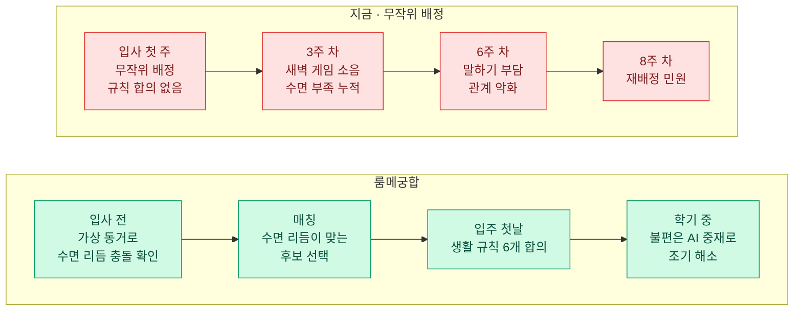
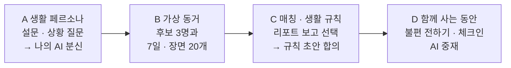
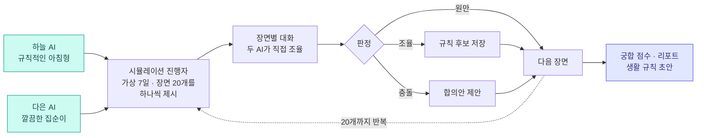
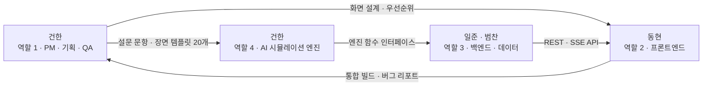

# 룸메궁합

**생활 페르소나 에이전트 기반 룸메이트 매칭** (가칭)

함께 살기 전, 두 사람의 AI 분신이 가상으로 먼저 살아보고 
잘 맞는 룸메이트와 생활 규칙을 제안합니다.

---

## 왜 만드나요?

기숙사 2인실 룸메이트는 대부분 무작위나 단순 설문으로 정해집니다. 설문 점수로는 **"새벽 1시에 룸메이트가 통화하면?"** 같은 실제 장면의 반응을 알 수 없고, 갈등은 같이 살아 본 뒤에야 드러납니다.

**룸메이트 갈등의 주요 원인** (영국 대학생·학부모 4,000명 이상, 복수 응답, 2026)

| 원인 | 비율 |
| --- | --- |
| 소음 | `█████████████` 26% |
| 음식 무단 사용 | `████████████` 24% |
| 정리·청소 | `███████████` 22% |
| 과소비 | `██████████` 20% |
| 금전 대차 | `█████████▌` 19% |
| 공과금 | `███████` 14% |

---

## 무엇을 만드나요?

| | 기능 | 하는 일 |
| --- | --- | --- |
| 1 | **생활 페르소나** | 설문 + 상황 질문 12문항으로 수면·청결·소음·대화 방식을 분석해 나의 AI 분신을 만든다 |
| 2 | **가상 동거 시뮬레이션** | 내 AI와 후보의 AI가 가상 7일 동안 생활 장면 20개를 함께 겪으며 직접 대화하고 조율한다 |
| 3 | **생활 규칙 자동 작성** | 시뮬레이션에서 합의한 내용을 6개 영역의 생활 규칙 초안으로 정리한다 |
| 4 | **AI 중재** | 입주 후 불편을 요청형 문장으로 다듬어 전하고 규칙 재협상을 돕는다 |

### 사용자 흐름

### 가상 동거는 이렇게 돌아가요

**생활 장면 20개**

| 카테고리 | 장면 |
| --- | --- |
| 수면·소음 | 새벽 통화 · 심야 게임 · 이른 알람 · 드라이기 소음 |
| 청결·청소 | 설거지 미루기 · 욕실 머리카락 · 청소 당번 |
| 공용 물품 | 냉장고 반찬 · 휴지·세제 소진 · 물건 무단 사용 · 공과금 분담 |
| 방문객 | 친구 초대 · 연인 방문 · 늦은 귀가 |
| 환경 | 난방 온도 · 환기 · 조명 |
| 특수 기간 | 시험 기간 · 실습 주간 · 주말 늦잠 |

### 화면 구성

4개 탭 · 핵심 흐름 4개 · 화면 15개

---

## 11/3 발표회에서 보여 줄 것

**AI·SW 신기술 전공 프로젝트 발표회** · 2026-11-03(화) 10:00 ~ 15:00 · 부스 시연

방문객이 직접 페르소나를 만들고, 시드 후보 3명과의 가상 동거를 지켜본 뒤, 생활 규칙 초안까지 받아 봅니다.

| 흐름 | 화면 | 발표회 |
| --- | --- | --- |
| A 생활 페르소나 | 매칭 시작 · 생활 설문 · 상황 질문 · 페르소나 카드 | ✅ 포함 |
| B 가상 동거 | 후보 목록 · 시뮬레이션 · 리포트 | ✅ 포함 (후보 비교는 여유 시) |
| C 매칭 · 생활 규칙 | 매칭 성사 · 생활 규칙 | ✅ 포함 (규칙 수정 · AI 중재는 여유 시) |
| D 함께 사는 동안 | 우리 방 · 불편 전하기 · 체크인 · 관리자 | ⏳ 최종 개발 (불편 전하기는 여유 시) |

## 일정

| 날짜 | 내용 |
| --- | --- |
| 10/20 ~ 10/26 | 중간고사 기간 · 문서 · 콘텐츠 준비 |
| **10/26(월)** | 발표 포스터 제출 |
| **10/27(화) ~ 11/1(일)** | 개발 (6일), 11/1 기능 동결 |
| 11/2(월) | 리허설 · 코드 프리즈 |
| **11/3(화)** | 프로젝트 발표회 |

날짜별 · 사람별 할 일은 [일정 문서](docs/SCHEDULE.md)에 있습니다.

---

## 팀

| 역할 | 담당 | 맡는 일 | 폴더 |
| --- | --- | --- | --- |
| **1. PM · 기획 · QA** | 건한 | 일정 관리, 설문 문항과 생활 장면 20개, 통합 테스트, 포스터 · 발표회 운영 | `docs/` `data/` |
| **2. 프론트엔드** | 동현 | 모바일 웹 화면(흐름 A~C), 시뮬레이션 실시간 화면 | `frontend/` |
| **3. 백엔드 · 데이터** | 일준 · 범찬 | API 서버, DB, 후보 추림, 매칭 · 규칙 로직, 시드 데이터, 엔진 연결 | `backend/` |
| **4. AI 시뮬레이션 엔진** | 건한 | 페르소나 생성, 에이전트 대화 루프, 판정자, 궁합 점수, 규칙 초안 | `engine/` |

## 기술 스택

| 영역 | 기술 |
| --- | --- |
| 프론트엔드 | React · TypeScript · Vite · Tailwind CSS |
| 백엔드 | Python · FastAPI · SQLite · SSE |
| AI 엔진 | Claude API (Haiku 5.5), 모델 교체 가능 구조 |

---

## 문서

| 문서 | 내용 |
| --- | --- |
| [PRD](docs/PRD.md) | 요구사항, 범위, 시뮬레이션 엔진 설계, 발표회 운영, 역할 |
| [API 명세서](docs/API.md) | 엔드포인트 21개, 데이터 모델, SSE 이벤트, 엔진 인터페이스 |
| [일정 · 간트 차트](docs/SCHEDULE.md) | 사람별 간트 차트, 마일스톤, 날짜별 할 일 |
| [협업 가이드](CONTRIBUTING.md) | 브랜치 · 커밋 · PR · 리뷰 규칙 |
| [서비스 기획서 v1.0 (PDF)](룸메궁합_서비스기획서_v1.0.pdf) | 제안 배경, 화면 설계, 수익 모델, 사업 확장 방안 |

## License

이 프로젝트는 [MIT License](LICENSE)를 따릅니다.
