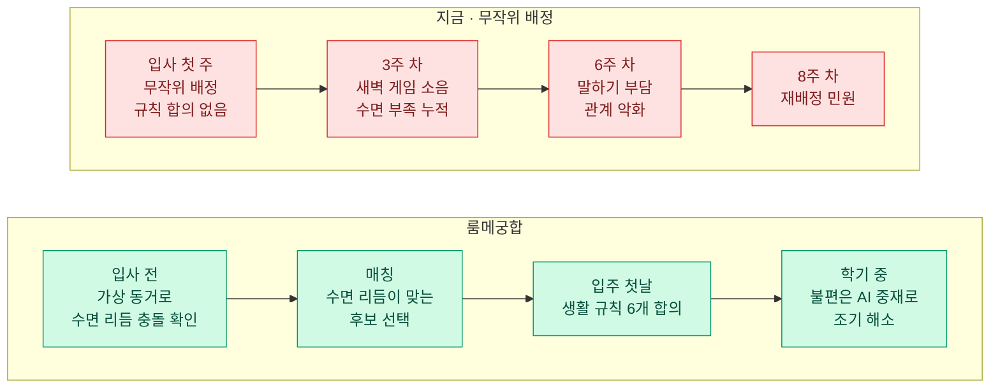
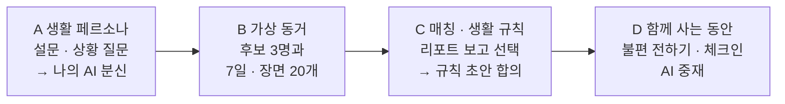
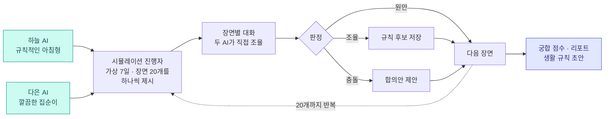

# 룸메궁합

**생활 페르소나 에이전트 기반 룸메이트 매칭** (가칭)

함께 살기 전, 두 사람의 AI 분신이 가상으로 먼저 살아보고 
잘 맞는 룸메이트와 생활 규칙을 제안합니다.

---

## 왜 만드나요?

기숙사 2인실 룸메이트는 대부분 무작위나 단순 설문으로 정해집니다. 설문 점수로는 **"새벽 1시에 룸메이트가 통화하면?"** 같은 실제 장면의 반응을 알 수 없고, 갈등은 같이 살아 본 뒤에야 드러납니다.

**룸메이트 갈등의 주요 원인** (영국 대학생·학부모 4,000명 이상, 복수 응답, 2026)

| 원인 | 비율 |
| --- | --- |
| 소음 | `█████████████` 26% |
| 음식 무단 사용 | `████████████` 24% |
| 정리·청소 | `███████████` 22% |
| 과소비 | `██████████` 20% |
| 금전 대차 | `█████████▌` 19% |
| 공과금 | `███████` 14% |

---

## 무엇을 만드나요?

| | 기능 | 하는 일 |
| --- | --- | --- |
| 1 | **생활 페르소나** | 설문 + 상황 질문 12문항으로 수면·청결·소음·대화 방식을 분석해 나의 AI 분신을 만든다 |
| 2 | **가상 동거 시뮬레이션** | 내 AI와 후보의 AI가 가상 7일 동안 생활 장면 20개를 함께 겪으며 직접 대화하고 조율한다 |
| 3 | **생활 규칙 자동 작성** | 시뮬레이션에서 합의한 내용을 6개 영역의 생활 규칙 초안으로 정리한다 |
| 4 | **AI 중재** | 입주 후 불편을 요청형 문장으로 다듬어 전하고 규칙 재협상을 돕는다 |

### 사용자 흐름

### 가상 동거는 이렇게 돌아가요

**생활 장면 20개**

| 카테고리 | 장면 |
| --- | --- |
| 수면·소음 | 새벽 통화 · 심야 게임 · 이른 알람 · 드라이기 소음 |
| 청결·청소 | 설거지 미루기 · 욕실 머리카락 · 청소 당번 |
| 공용 물품 | 냉장고 반찬 · 휴지·세제 소진 · 물건 무단 사용 · 공과금 분담 |
| 방문객 | 친구 초대 · 연인 방문 · 늦은 귀가 |
| 환경 | 난방 온도 · 환기 · 조명 |
| 특수 기간 | 시험 기간 · 실습 주간 · 주말 늦잠 |

### 화면 구성

4개 탭 · 핵심 흐름 4개 · 화면 15개

---

## 11/1 중간 시연 범위

| 흐름 | 화면 | 중간 시연 |
| --- | --- | --- |
| A 생활 페르소나 | 매칭 시작 · 생활 설문 · 상황 질문 · 페르소나 카드 | ✅ 포함 |
| B 가상 동거 | 후보 목록 · 시뮬레이션 · 리포트 | ✅ 포함 (후보 비교는 여유 시) |
| C 매칭 · 생활 규칙 | 매칭 성사 · 생활 규칙 | ✅ 포함 (규칙 수정 · AI 중재는 여유 시) |
| D 함께 사는 동안 | 우리 방 · 불편 전하기 · 체크인 · 관리자 | ⏳ 최종 개발 (불편 전하기는 여유 시) |

자세한 요구사항, 일정, 역할 구분은 [PRD](docs/PRD.md)에 있습니다.

---

## 문서

| 문서 | 내용 |
| --- | --- |
| [PRD](docs/PRD.md) | 요구사항, 범위, 시뮬레이션 엔진 설계, 일정, 역할 구분 |
| [서비스 기획서 v1.0 (PDF)](룸메궁합_서비스기획서_v1.0.pdf) | 제안 배경, 화면 설계, 수익 모델, 사업 확장 방안 |

## License

이 프로젝트는 [MIT License](LICENSE)를 따릅니다.
