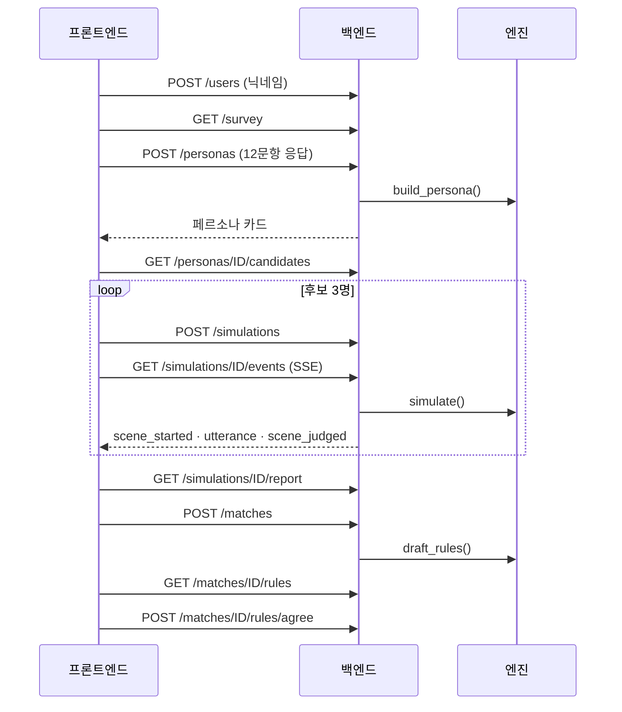

# 룸메궁합 API 명세서

| 항목 | 내용 |
| --- | --- |
| 버전 | v1.0 초안 (2026-10-19) |
| 확정 | 10/26까지 리뷰 → 10/27 개발 시작과 함께 확정 |
| 담당 | 백엔드 일준 · 범찬, 프론트엔드 동현, 엔진 인터페이스 건한 |
| 변경 규칙 | 이 문서를 먼저 고치는 PR → 동현 + 백엔드 1명 승인 → 구현 |
| 구현 후 기준 | FastAPI가 만드는 `http://localhost:8000/docs`. 이 문서와 다르면 이 문서를 고친다 |
| 함께 보는 문서 | [PRD](PRD.md) · [일정](SCHEDULE.md) · [협업 가이드](../CONTRIBUTING.md) |

## 목차

1. [공통 규칙](#1-공통-규칙)
2. [한눈에 보기](#2-한눈에-보기)
3. [데이터 모델](#3-데이터-모델)
4. [엔드포인트 상세](#4-엔드포인트-상세)
5. [실시간 이벤트 (SSE)](#5-실시간-이벤트-sse)
6. [오류 코드](#6-오류-코드)
7. [엔진 인터페이스](#7-엔진-인터페이스)
8. [로컬 개발 연결](#8-로컬-개발-연결)

---

## 1. 공통 규칙

| 항목 | 규칙 |
| --- | --- |
| Base URL | 백엔드 `http://localhost:8000/api`. 프론트엔드는 `/api`로 호출하고 Vite 프록시가 백엔드로 넘긴다 |
| 형식 | JSON (UTF-8). 필드 이름은 `snake_case` |
| ID | 문자열. 접두사 + 8자리: `usr_` 사용자, `per_` 페르소나, `sim_` 시뮬레이션, `mat_` 매칭, `rul_` 규칙, `prp_` 수정 제안. 시드 데이터는 읽기 쉬운 ID (`per_haneul`, `per_daeun`) |
| 시각 | 날짜·시각은 ISO 8601 KST (`2026-11-03T10:15:00+09:00`), 하루 중 시각은 `"HH:MM"` |
| 사용자 식별 | 로그인 없음. `POST /api/users`로 받은 `user_id`를 이후 요청 헤더 `X-User-Id`에 넣는다 (최종 버전에서 학교 메일 인증으로 교체) |
| 오류 | `{ "error": { "code": "...", "message": "..." } }` 형식 ([6장](#6-오류-코드)) |

**공통 값**

| 이름 | 값 |
| --- | --- |
| 판정 `verdict` | `harmonious` 원만 · `negotiated` 조율 · `conflict` 충돌 · `pending` 판정 보류 |
| 대화 방식 `conflict_style` | `direct` 직설 · `avoid` 회피 · `delay` 지연 |
| 규칙 영역 `area` | `quiet_hours` 조용한 시간 · `guests` 친구 초대 · `cleaning` 청소 · `fridge` 냉장고 · `climate` 냉난방 · `supplies` 공용품 |
| 시뮬레이션 모드 `mode` | `agents` 기본 · `single` 장면 일괄 생성 · `replay` 사전 생성 결과 재생 |
| 시뮬레이션 상태 `status` | `queued` · `running` · `completed` · `failed` |

---

## 2. 한눈에 보기



| # | 메서드 | 경로 | 설명 | 우선순위 | 구현 (제안) | 화면 |
| --- | --- | --- | --- | --- | --- | --- |
| 1 | GET | `/api/health` | 서버 · LLM 상태 | P0 | 일준 | - |
| 2 | POST | `/api/users` | 닉네임으로 사용자 생성 | P0 | 일준 | A1 |
| 3 | GET | `/api/survey` | 설문 12문항 | P0 | 일준 | A2 · A3 |
| 4 | POST | `/api/personas` | 응답 → 페르소나 생성 | P0 | 일준 | A4 |
| 5 | GET | `/api/personas/{persona_id}` | 페르소나 조회 | P0 | 일준 | A4 |
| 6 | PATCH | `/api/personas/{persona_id}` | 꼭 지켜줘 · 괜찮아요 수정 | P0 | 일준 | A4 |
| 7 | GET | `/api/personas/{persona_id}/candidates` | 후보 3명 | P0 | 범찬 | B1 |
| 8 | POST | `/api/simulations` | 시뮬레이션 시작 | P0 | 일준 | B1 · B2 |
| 9 | GET | `/api/simulations/{simulation_id}` | 상태 · 진행률 | P0 | 일준 | B1 · B2 |
| 10 | GET | `/api/simulations/{simulation_id}/events` | 실시간 이벤트 (SSE) | P0 | 일준 | B2 |
| 11 | GET | `/api/simulations/{simulation_id}/report` | 리포트 | P0 | 범찬 | B3 |
| 12 | POST | `/api/matches` | 룸메 신청 (시드 후보는 자동 수락) | P0 | 범찬 | C1 |
| 13 | GET | `/api/matches/{match_id}` | 매칭 정보 | P0 | 범찬 | C1 |
| 14 | GET | `/api/matches/{match_id}/rules` | 생활 규칙 초안 | P0 | 범찬 | C2 |
| 15 | POST | `/api/matches/{match_id}/rules/agree` | 규칙 동의 | P0 | 범찬 | C2 |
| 16 | GET | `/api/simulations/{simulation_id}/scenes` | 장면별 대화 전문 (다시 보기) | P1 | 일준 | B3 |
| 17 | GET | `/api/personas/{persona_id}/comparison` | 후보 비교 (레이더 차트) | P1 | 범찬 | B4 |
| 18 | POST | `/api/rules/{rule_id}/proposals` | 규칙 수정 제안 → AI 중재안 | P1 | 범찬 | C3 |
| 19 | POST | `/api/proposals/{proposal_id}/accept` | 중재안 수락 | P1 | 범찬 | C3 |
| 20 | POST | `/api/mediation/rephrase` | 불편 메모 → 요청형 문장 | P1 | 일준 | D2 |
| 21 | POST | `/api/matches/{match_id}/accept` | 상대 수락 (실사용자끼리 매칭) | P2 | - | - |

---

## 3. 데이터 모델

### Persona

```json
{
  "persona_id": "per_haneul",
  "user_id": "usr_haneul",
  "nickname": "하늘",
  "type_name": "규칙적인 아침형",
  "summary": "23시 취침 · 6시 반 기상. 불편하면 바로, 부드럽게 말하는 편.",
  "sleep": { "bedtime": "23:00", "wake": "06:30", "exam_pattern": "earlier" },
  "axes": {
    "sleep_rhythm": 33,
    "noise_sensitivity": 67,
    "cleanliness": 84,
    "sociability": 33,
    "sharing_tolerance": 0
  },
  "axis_labels": {
    "sleep_rhythm": "아침형",
    "noise_sensitivity": "예민",
    "cleanliness": "높음",
    "sociability": "보통",
    "sharing_tolerance": "낮음"
  },
  "conflict_style": "direct",
  "preferences": { "temperature": "moderate" },
  "must_keep": ["24시 이후 통화·게임 소리 X"],
  "okay_with": ["친구 초대 (미리 말하면)"],
  "is_seed": true,
  "created_at": "2026-11-03T10:12:00+09:00"
}
```

| 필드 | 설명 |
| --- | --- |
| `axes` | 5개 축 0~100. 계산 규칙은 [PRD 부록 C](PRD.md#부록-c-계산-규칙-초안). `sleep_rhythm`은 0 = 아침형, 100 = 올빼미 |
| `axis_labels` | 화면에 그대로 쓰는 이름표 (서버가 계산) |
| `sleep.exam_pattern` | q03 응답: `same` · `earlier` · `later` · `all_nighter` |
| `preferences.temperature` | q06 응답: `warm` · `moderate` · `cool` · `any` |
| `must_keep` · `okay_with` | 각 최대 3개, 항목당 30자 이내. 생성 시 LLM이 후보를 제안하고 사용자가 수정 |

### Candidate

```json
{
  "candidate_id": "per_daeun",
  "alias": "후보 A",
  "department": "간호학과",
  "year": 1,
  "type_name": "깔끔한 집순이",
  "pre_score": 86,
  "highlight": "청결 기준 비슷",
  "simulation": {
    "simulation_id": "sim_7k2m9q1a",
    "status": "completed",
    "progress": { "done": 20, "total": 20 },
    "score": 88
  }
}
```

- 매칭 전에는 이름을 주지 않는다. `alias`는 1차 점수 순서대로 후보 A · B · C.
- `simulation`은 아직 시작하지 않았으면 `null`.

### Simulation

```json
{
  "simulation_id": "sim_7k2m9q1a",
  "persona_id": "per_haneul",
  "candidate_id": "per_daeun",
  "mode": "live",
  "status": "running",
  "progress": { "done": 9, "total": 20 },
  "verdict_counts": { "harmonious": 7, "negotiated": 2, "conflict": 0, "pending": 0 },
  "score": null,
  "started_at": "2026-11-03T10:14:05+09:00",
  "completed_at": null
}
```

`mode`의 `live`는 `agents` 또는 `single` 중 서버 설정(`SIM_MODE`)으로 실행한 것을 뜻한다.

### SceneResult

```json
{
  "scene_index": 9,
  "scene": {
    "scene_id": "S09",
    "day": 3,
    "weekday": "수",
    "time": "01:10",
    "category": "수면·소음",
    "title": "심야 게임",
    "situation": "후보 C가 친구와 음성 채팅으로 게임 중, 하늘은 내일 9시 수업"
  },
  "dialogue": [
    { "turn": 1, "speaker": "me", "name": "하늘 AI", "text": "내일 아침 수업이라 이제 자야 할 것 같아. 혹시 헤드셋 쓰고 조금만 작게 해줄 수 있어?" },
    { "turn": 2, "speaker": "candidate", "name": "후보 C AI", "text": "아 미안! 게임은 보통 이 시간이 제일 재밌는데… 헤드셋은 쓸 수 있어. 대신 주말 밤엔 좀 봐줘?" },
    { "turn": 3, "speaker": "me", "name": "하늘 AI", "text": "좋아. 평일 24시 이후엔 헤드셋, 금·토는 1시까지 괜찮아." }
  ],
  "verdict": "negotiated",
  "reason": "소음 기준 차이가 있었으나 헤드셋 사용으로 합의",
  "agreement": "평일 24시 이후 헤드셋, 금·토는 1시까지",
  "rule_candidate": { "area": "quiet_hours", "text": "평일 24시 이후 헤드셋 사용" },
  "unresolved": null
}
```

- `speaker`는 `me`(내 AI) 또는 `candidate`(후보 AI). 매칭 전 후보 이름은 `후보 C AI`처럼 별칭으로 표시한다.
- 발화는 최대 4개. 합의가 일찍 끝나면 더 짧을 수 있다.

### Report

```json
{
  "simulation_id": "sim_7k2m9q1a",
  "candidate": { "candidate_id": "per_daeun", "alias": "후보 A", "type_name": "깔끔한 집순이" },
  "score": 88,
  "headline": "함께 살기 무난한 조합이에요",
  "verdict_counts": { "harmonious": 16, "negotiated": 3, "conflict": 1, "pending": 0 },
  "scene_verdicts": [
    "harmonious", "harmonious", "harmonious", "harmonious", "harmonious",
    "negotiated", "negotiated", "harmonious", "harmonious", "harmonious",
    "harmonious", "harmonious", "harmonious", "conflict", "harmonious",
    "negotiated", "harmonious", "harmonious", "harmonious", "harmonious"
  ],
  "highlights": [
    { "scene_index": 14, "day": 5, "title": "냉장고 반찬", "verdict": "conflict", "agreement": "칸 나누기 + 공용 칸은 주 1회 정리" },
    { "scene_index": 6, "day": 2, "title": "난방 온도", "verdict": "negotiated", "agreement": "밤 23도로 합의" },
    { "scene_index": 7, "day": 3, "title": "친구 초대", "verdict": "negotiated", "agreement": "하루 전 공지, 주 1회, 22시까지" },
    { "scene_index": 16, "day": 6, "title": "주말 늦잠", "verdict": "negotiated", "agreement": "청소는 일요일 오후 2시" }
  ],
  "expected_conflicts_per_month": null
}
```

- `scene_verdicts`는 장면 순서대로 20개. 진행 막대 색에 쓴다.
- `highlights`는 충돌 → 조율 순, 같은 판정은 장면 순서대로.
- `expected_conflicts_per_month`는 P1. 산식이 정해지기 전까지 `null`.

### Match

```json
{
  "match_id": "mat_3p8x2c4d",
  "simulation_id": "sim_7k2m9q1a",
  "status": "accepted",
  "partner": {
    "persona_id": "per_daeun",
    "name": "다은",
    "department": "간호학과",
    "year": 1,
    "type_name": "깔끔한 집순이",
    "greeting": "아침형이시라니 반가워요! 저도 실습 때문에 일찍 자요 🙂"
  },
  "room": "302호 (배정 예정)",
  "rules_status": "draft"
}
```

`status`: `pending` · `accepted` · `declined`. 시드 후보는 신청 즉시 `accepted`이고, 이때부터 `partner.name`을 공개한다.

### RuleSet

```json
{
  "match_id": "mat_3p8x2c4d",
  "status": "draft",
  "rules": [
    { "rule_id": "rul_q1w2e3r4", "area": "quiet_hours", "area_label": "조용한 시간", "text": "23:30 ~ 07:00", "source": { "scene_index": 4, "day": 2, "verdict": "harmonious" } },
    { "rule_id": "rul_t5y6u7i8", "area": "guests", "area_label": "친구 초대", "text": "하루 전 공지 · 주 1회 · 22시까지", "source": { "scene_index": 7, "day": 3, "verdict": "negotiated" } },
    { "rule_id": "rul_o9p0a1s2", "area": "cleaning", "area_label": "청소", "text": "일요일 14시 · 격주 화장실 당번", "source": { "scene_index": 16, "day": 6, "verdict": "negotiated" } },
    { "rule_id": "rul_d3f4g5h6", "area": "fridge", "area_label": "냉장고", "text": "칸 나누기 · 공용 칸 주 1회 정리", "source": { "scene_index": 14, "day": 5, "verdict": "conflict" } },
    { "rule_id": "rul_j7k8l9z0", "area": "climate", "area_label": "냉난방", "text": "밤 23도 · 외출 시 끄기", "source": { "scene_index": 6, "day": 2, "verdict": "negotiated" } },
    { "rule_id": "rul_x1c2v3b4", "area": "supplies", "area_label": "공용품", "text": "휴지·세제 번갈아 구매 · 앱 정산", "source": { "scene_index": 11, "day": 4, "verdict": "harmonious" } }
  ],
  "agreements": { "me": false, "partner": false }
}
```

- 6개 영역마다 규칙 1개. 화면의 출처 표시는 `source`로 만든다 (예: `5일차 충돌`, `2일차 장면`).
- `status`: `draft` → 양쪽이 동의하면 `confirmed`.

---

## 4. 엔드포인트 상세

`X-User-Id` 헤더는 `POST /api/users`, `GET /api/health`, `GET /api/survey`를 뺀 모든 요청에 넣는다.

### 4.1 GET /api/health

서버와 LLM 설정 확인. 프론트엔드는 처음 세팅할 때 연결 확인용으로 쓴다.

```jsonc
// 200
{ "status": "ok", "llm": { "provider": "anthropic", "model": "claude-haiku-5-5" }, "sim_mode": "agents" }
```

### 4.2 POST /api/users

```jsonc
// 요청
{ "nickname": "하늘" }

// 201
{ "user_id": "usr_k3j9x2ab", "nickname": "하늘", "created_at": "2026-11-03T10:11:30+09:00" }
```

- `nickname`: 1~10자. 중복 허용.
- 오류: `422 VALIDATION_ERROR`

### 4.3 GET /api/survey

설문 12문항. 문항 내용은 `data/seed/survey.json`(PM 관리)에서 읽으므로 프론트엔드는 문구를 하드코딩하지 않는다.

```jsonc
// 200
{
  "version": "2026-10-26",
  "questions": [
    {
      "question_id": "q01",
      "section": "life",
      "type": "time_range",
      "title": "평일에는 보통 몇 시에 자고 일어나요?",
      "fields": [
        { "key": "bedtime", "label": "취침", "min": "21:00", "max": "03:00", "step_minutes": 30, "default": "23:00" },
        { "key": "wake", "label": "기상", "min": "05:00", "max": "11:00", "step_minutes": 30, "default": "07:00" }
      ]
    },
    {
      "question_id": "q02",
      "section": "life",
      "type": "choice",
      "title": "잠잘 때 소리에 얼마나 예민해요?",
      "options": [
        { "value": "insensitive", "label": "둔감" },
        { "value": "normal", "label": "보통" },
        { "value": "sensitive", "label": "예민" },
        { "value": "very_sensitive", "label": "아주 예민" }
      ]
    },
    {
      "question_id": "q09",
      "section": "situation",
      "type": "choice",
      "title": "룸메이트가 새벽 1시에 친구와 통화하고 있어요",
      "hint": "정답은 없어요. 내 AI가 시뮬레이션에서 나처럼 대화하도록 쓰여요.",
      "options": [
        { "value": "say_now", "label": "\"조금만 작게 해줄래?\" 바로 말한다", "style": "direct" },
        { "value": "earplugs", "label": "이어폰을 끼고 그냥 잔다", "style": "avoid" },
        { "value": "talk_tomorrow", "label": "참았다가 다음 날 이야기한다", "style": "delay" },
        { "value": "step_out", "label": "잠깐 밖에 나가 있는다", "style": "avoid" }
      ]
    }
  ]
}
```

- `section`: `life` 생활 설문(q01~q08) · `situation` 상황 질문(q09~q12)
- `type`: `time_range` 슬라이더 · `choice` 4지선다
- 위는 3문항만 보인 예시다. 전체 문항은 [PRD 부록 A](PRD.md#부록-a-설문-12문항-초안).

### 4.4 POST /api/personas

```jsonc
// 요청 (X-User-Id 헤더 필요)
{
  "answers": {
    "q01": { "bedtime": "23:00", "wake": "06:30" },
    "q02": "sensitive",
    "q03": "earlier",
    "q04": "every_2_3_days",
    "q05": "right_away",
    "q06": "moderate",
    "q07": "when_needed",
    "q08": "all_separate",
    "q09": "say_now",
    "q10": "ask_now",
    "q11": "say_now",
    "q12": "after_friend_leaves"
  }
}

// 201 → Persona
```

- 각 값은 `GET /api/survey`의 `options[].value`(시간 범위 문항은 `fields[].key`별 시각)를 그대로 보낸다.
- 응답까지 최대 10초 (LLM이 유형명 · 요약 · 꼭 지켜줘/괜찮아요 후보를 만든다). LLM이 실패하면 서버가 규칙 기반 문구로 대신 채워 **실패 응답을 내지 않는다**.
- 오류: `400 SURVEY_INCOMPLETE` (빠진 문항 ID를 `message`에 표시), `401 USER_REQUIRED`, `422 VALIDATION_ERROR`

### 4.5 GET /api/personas/{persona_id}

`200` → Persona · 오류: `404 PERSONA_NOT_FOUND`

### 4.6 PATCH /api/personas/{persona_id}

```jsonc
// 요청 (보낸 필드만 바뀐다)
{ "must_keep": ["24시 이후 통화·게임 소리 X"], "okay_with": ["친구 초대 (미리 말하면)", "공용품 같이 쓰기"] }

// 200 → Persona
```

- 이미 끝난 시뮬레이션은 다시 돌리지 않는다. 이후 시작하는 시뮬레이션부터 반영된다.
- 오류: `404 PERSONA_NOT_FOUND`, `422 VALIDATION_ERROR` (3개 초과, 30자 초과)

### 4.7 GET /api/personas/{persona_id}/candidates

시드 후보 풀(10명, 나 제외)에서 1차 점수 상위 3명.

```jsonc
// 200
{ "candidates": [ /* Candidate × 3, pre_score 내림차순 */ ] }
```

오류: `404 PERSONA_NOT_FOUND`

### 4.8 POST /api/simulations

```jsonc
// 요청
{ "persona_id": "per_haneul", "candidate_id": "per_daeun", "mode": "live" }

// 202 → Simulation (status: queued 또는 running)
```

- `mode`: `live`(기본) 또는 `replay`. `replay`인데 사전 생성 파일이 없으면 `live`로 실행하고, 응답의 `mode`에 실제로 실행한 모드를 담는다.
- 같은 페르소나 · 후보 · 모드로 이미 `running`이거나 `completed`인 시뮬레이션이 있으면 새로 만들지 않고 `200`으로 그것을 돌려준다.
- 오류: `404 PERSONA_NOT_FOUND`

### 4.9 GET /api/simulations/{simulation_id}

`200` → Simulation. SSE 연결이 안 될 때 2초 간격 폴링용으로도 쓴다. 오류: `404 SIMULATION_NOT_FOUND`

### 4.10 GET /api/simulations/{simulation_id}/events

SSE 스트림. [5장](#5-실시간-이벤트-sse) 참고.

### 4.11 GET /api/simulations/{simulation_id}/report

`200` → Report · 오류: `404 SIMULATION_NOT_FOUND`, `409 SIMULATION_NOT_COMPLETED`

### 4.12 POST /api/matches

```jsonc
// 요청
{ "simulation_id": "sim_7k2m9q1a" }

// 201 → Match
```

- 시드 후보는 즉시 수락(`accepted`)되고, 이 요청 안에서 엔진이 생활 규칙 초안을 만든다 (최대 10초).
- 오류: `404 SIMULATION_NOT_FOUND`, `409 SIMULATION_NOT_COMPLETED`

### 4.13 GET /api/matches/{match_id}

`200` → Match · 오류: `404 MATCH_NOT_FOUND`

### 4.14 GET /api/matches/{match_id}/rules

`200` → RuleSet · 오류: `404 MATCH_NOT_FOUND`

### 4.15 POST /api/matches/{match_id}/rules/agree

요청 본문 없음. 내 동의를 기록하고, 시드 후보는 자동으로 동의한다.

```jsonc
// 200 → RuleSet
{ "match_id": "mat_3p8x2c4d", "status": "confirmed", "rules": [ /* ... */ ], "agreements": { "me": true, "partner": true } }
```

### 4.16 P1 엔드포인트

**GET /api/simulations/{simulation_id}/scenes** — `200` `{ "scenes": [SceneResult × 20] }`

**GET /api/personas/{persona_id}/comparison**

```jsonc
// 200
{
  "me": { "axes": { "sleep_rhythm": 33, "noise_sensitivity": 67, "cleanliness": 84, "sociability": 33, "sharing_tolerance": 0 } },
  "candidates": [
    {
      "candidate_id": "per_daeun",
      "alias": "후보 A",
      "axes": { "sleep_rhythm": 25, "noise_sensitivity": 67, "cleanliness": 100, "sociability": 33, "sharing_tolerance": 33 },
      "score": 88,
      "expected_conflicts_per_month": 0.5
    }
  ],
  "recommended_candidate_id": "per_daeun"
}
```

**POST /api/rules/{rule_id}/proposals**

```jsonc
// 요청
{ "text": "시험 기간엔 22:30부터", "reason": "실습 평가 주간엔 일찍 자야 해서요" }

// 201
{
  "proposal_id": "prp_9d8s7a6f",
  "rule_id": "rul_q1w2e3r4",
  "mediation": {
    "text": "시험 기간 22:30부터 조용한 시간, 대신 아침 드라이기는 욕실에서 사용",
    "rationale": ["아침형이라 22:30 취침과 충돌 적음", "실습 기간 수면 확보"]
  }
}
```

**POST /api/proposals/{proposal_id}/accept** — `200` → 바뀐 Rule

**POST /api/mediation/rephrase**

```jsonc
// 요청
{ "match_id": "mat_3p8x2c4d", "memo": "요즘 다은이 새벽에 알람을 여러 번 끄고 다시 자서 나도 깨… 짜증나" }

// 200
{
  "message": "요즘 아침 알람 소리에 나도 같이 깨더라 😅 진동으로 바꾸거나 한 번만 울리게 해줄 수 있을까?",
  "suggested_rule": { "area": "quiet_hours", "text": "평일 알람은 진동 · 다시 알림 1회까지" }
}
```

메모 원문은 저장하지 않고 상대에게 보내지 않는다.

---

## 5. 실시간 이벤트 (SSE)

`GET /api/simulations/{simulation_id}/events` (`Content-Type: text/event-stream`)

### 5.1 이벤트 종류

| `event` | 언제 | `data` |
| --- | --- | --- |
| `simulation_started` | 연결 직후 1회 | `{ simulation_id, mode, total_scenes, me: { name, type_name }, candidate: { alias, type_name } }` |
| `scene_started` | 장면 시작 | `{ scene_index, scene: { scene_id, day, weekday, time, category, title, situation } }` |
| `utterance` | 발화 1개 | `{ scene_index, turn, speaker, name, text }` |
| `scene_judged` | 장면 판정 | `{ scene_index, verdict, reason, agreement, rule_candidate, unresolved, progress: { done, total } }` |
| `simulation_completed` | 20장면 종료 | `{ score, headline, verdict_counts }` |
| `error` | 오류 | `{ code, message, scene_index, retryable }` |

### 5.2 예시

```text
id: 9-0
event: scene_started
data: {"scene_index":9,"scene":{"scene_id":"S09","day":3,"weekday":"수","time":"01:10","category":"수면·소음","title":"심야 게임","situation":"후보 C가 친구와 음성 채팅으로 게임 중, 하늘은 내일 9시 수업"}}

id: 9-1
event: utterance
data: {"scene_index":9,"turn":1,"speaker":"me","name":"하늘 AI","text":"내일 아침 수업이라 이제 자야 할 것 같아. 혹시 헤드셋 쓰고 조금만 작게 해줄 수 있어?"}

id: 9-4
event: scene_judged
data: {"scene_index":9,"verdict":"negotiated","reason":"소음 기준 차이가 있었으나 헤드셋 사용으로 합의","agreement":"평일 24시 이후 헤드셋, 금·토는 1시까지","rule_candidate":{"area":"quiet_hours","text":"평일 24시 이후 헤드셋 사용"},"unresolved":null,"progress":{"done":9,"total":20}}
```

### 5.3 규칙

- 이벤트 `id`는 `{scene_index}-{순번}`. 시작 이벤트는 `0-0`.
- 서버는 모든 이벤트를 DB에 저장한다. 연결이 끊겼다가 다시 붙으면 브라우저가 보내는 `Last-Event-ID` 다음부터 다시 보내고, 헤더가 없으면 처음부터 보낸다. 이미 끝난 시뮬레이션에 연결해도 전체 이벤트를 받은 뒤 `simulation_completed`로 끝난다.
- 15초마다 `: ping` 주석을 보내 연결을 유지한다.
- `replay` 모드는 같은 이벤트를 `REPLAY_DELAY_MS` 간격으로 보낸다.
- 장면 판정이 실패하면 `scene_judged`의 `verdict`가 `pending`으로 오고 다음 장면으로 넘어간다.

### 5.4 프론트엔드 사용 예

```ts
const es = new EventSource(`/api/simulations/${simulationId}/events`);

es.addEventListener("scene_started", (e) => onSceneStarted(JSON.parse(e.data)));
es.addEventListener("utterance", (e) => onUtterance(JSON.parse(e.data)));
es.addEventListener("scene_judged", (e) => onSceneJudged(JSON.parse(e.data)));
es.addEventListener("simulation_completed", (e) => {
  onCompleted(JSON.parse(e.data));
  es.close();
});
```

같은 `id`의 이벤트가 두 번 올 수 있으니(재연결) 화면에 넣기 전에 `id`로 중복을 거른다.

---

## 6. 오류 코드

```json
{ "error": { "code": "PERSONA_NOT_FOUND", "message": "페르소나를 찾을 수 없어요." } }
```

| HTTP | `code` | 의미 |
| --- | --- | --- |
| 400 | `SURVEY_INCOMPLETE` | 12문항 중 빠진 응답이 있음 |
| 401 | `USER_REQUIRED` | `X-User-Id`가 없거나 없는 사용자 |
| 404 | `USER_NOT_FOUND` · `PERSONA_NOT_FOUND` · `SIMULATION_NOT_FOUND` · `MATCH_NOT_FOUND` · `RULE_NOT_FOUND` | 대상 없음 |
| 409 | `SIMULATION_NOT_COMPLETED` | 시뮬레이션이 끝나기 전에 리포트 · 매칭 요청 |
| 422 | `VALIDATION_ERROR` | 형식 오류 (FastAPI 기본 422 응답을 이 형식으로 감싼다) |
| 429 | `LLM_RATE_LIMITED` | LLM 분당 한도 초과. 잠시 후 재시도 |
| 503 | `LLM_UNAVAILABLE` | LLM 호출 실패. 부스에서는 리플레이 모드로 전환 |
| 500 | `INTERNAL_ERROR` | 그 밖의 서버 오류 |

---

## 7. 엔진 인터페이스

백엔드(일준 · 범찬)와 엔진(건한) 사이의 약속이다. 백엔드는 `engine` 패키지에서 아래 함수만 가져다 쓴다.

```python
# engine/__init__.py
from typing import AsyncIterator
from engine.models import Persona, SceneTemplate, SimEvent, SceneJudgement, RuleDraft, Mediation, Rephrased

async def build_persona(nickname: str, answers: dict) -> Persona:
    """12문항 응답 → 페르소나 (5개 축 계산 + 유형명 · 요약 · 꼭 지켜줘/괜찮아요 후보 생성)"""

def load_scenes() -> list[SceneTemplate]:
    """data/seed/scenes.json의 장면 20개"""

async def simulate(me: Persona, candidate: Persona, *, mode: str = "agents") -> AsyncIterator[SimEvent]:
    """장면 20개를 순서대로 실행하며 이벤트를 하나씩 내보낸다 (mode: agents | single)"""

def score(judgements: list[SceneJudgement]) -> int:
    """궁합 점수 (PRD 8.5)"""

def headline(score: int) -> str:
    """한 줄 판정 (PRD 8.5)"""

async def draft_rules(me: Persona, candidate: Persona, judgements: list[SceneJudgement]) -> list[RuleDraft]:
    """6개 영역 생활 규칙 초안"""

# P1
async def mediate(rule: RuleDraft, proposal_text: str, reason: str, proposer: Persona, other: Persona) -> Mediation: ...
async def rephrase(memo: str, sender: Persona, receiver: Persona) -> Rephrased: ...
```

| 약속 | 내용 |
| --- | --- |
| 모델 | `engine/models.py`의 Pydantic 모델. 필드 이름은 이 문서 3장과 같다 (ID 필드는 백엔드가 붙인다) |
| 이벤트 | `SimEvent`는 `{ "type": "utterance", "data": {...} }` 모양으로 5장의 SSE 이벤트와 같다. 백엔드는 받은 이벤트를 저장하고 그대로 SSE로 내보낸다 |
| 의존성 | 엔진은 FastAPI · DB를 모른다. 순수 Python + Anthropic SDK |
| 가짜 엔진 | `engine/fake.py`는 같은 함수 이름으로 `data/replays/`의 결과를 돌려준다. 엔진 완성 전 백엔드 개발과 `replay` 모드에 같이 쓴다 |
| 단독 실행 | `python -m engine.cli simulate --me per_haneul --candidate per_daeun`로 터미널에서 결과를 확인할 수 있게 한다 |

---

## 8. 로컬 개발 연결

### 8.1 포트와 프록시

| 서비스 | 주소 |
| --- | --- |
| 프론트엔드 (Vite) | `http://localhost:5173` |
| 백엔드 (FastAPI) | `http://localhost:8000` (API 문서 `/docs`) |

```ts
// frontend/vite.config.ts
export default defineConfig({
  server: { proxy: { "/api": "http://localhost:8000" } },
});
```

프록시를 쓰면 브라우저 입장에서 같은 주소라 CORS 설정이 필요 없다.

### 8.2 mock으로 먼저 개발하기

- 프론트엔드는 이 문서의 JSON 예시로 mock 응답을 만들어 화면을 먼저 개발한다 (`VITE_USE_MOCK=true`).
- 백엔드는 엔진 완성 전까지 가짜 엔진을 쓴다.
- 10/28(M1)까지 화면 → API → 가짜 엔진 → DB를 한 줄로 연결해 통합 문제를 일찍 찾는다.

### 8.3 환경변수 (`backend/.env`)

| 이름 | 예시 | 설명 |
| --- | --- | --- |
| `ANTHROPIC_API_KEY` | (비공개) | 건한에게 받는다. 커밋 금지 |
| `LLM_PROVIDER` | `anthropic` | 다른 API로 바꿀 때 |
| `LLM_MODEL` | `claude-haiku-5-5` | |
| `LLM_MAX_CONCURRENCY` | `8` | 동시 LLM 요청 수 상한 |
| `SIM_MODE` | `agents` | `agents` · `single` · `replay` |
| `REPLAY_DELAY_MS` | `600` | 리플레이 발화 간격 |
| `DATABASE_URL` | `sqlite:///./roommate.db` | |

예시 파일: [`backend/.env.example`](../backend/.env.example)
