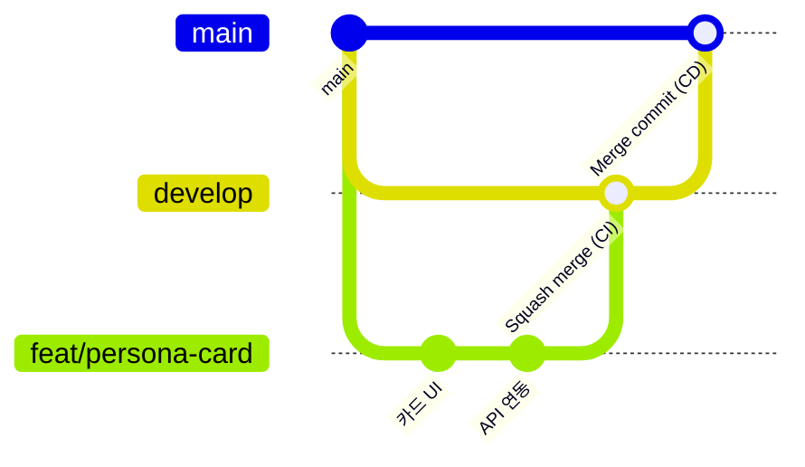

# 협업 가이드

- 룸메궁합 팀의 GitHub 협업 규칙
- 개발 착수 **10/27(화)**, 기능 동결 **11/1(일)**

## 팀과 담당

| 이름 | 역할 | 담당 폴더 | 주요 참고 문서 |
| --- | --- | --- | --- |
| 건한 | PM · 기획 · QA, AI 시뮬레이션 엔진 | `docs/` `engine/` `data/` | [PRD](PRD.md) · [일정](SCHEDULE.md) |
| 동현 | 프론트엔드 | `frontend/` | [API 명세서](API.md) 1~5장 |
| 일준 | 백엔드 | `backend/` | [API 명세서](API.md) 전체 |
| 범찬 | 백엔드 · 데이터 | `backend/` `data/seed/` | [API 명세서](API.md) 전체 |

## 작업 흐름



| 브랜치 | 역할 | 병합 방식 | 자동화 |
| --- | --- | --- | --- |
| 작업 브랜치 (`feat/` 등) | 개인 작업 | → `develop` **Squash and merge** | push마다 CI |
| `develop` | 통합 · 검증 (기본 작업 기준) | → `main` **Create a merge commit** | CI |
| `main` | 배포 · 발표회 버전 | — | CD (Docker 이미지 → VM 배포) |

1. **할 일 확인** — [일정 문서](SCHEDULE.md)의 날짜별 할 일 표 내 당일 담당 칸 확인
2. **브랜치** — 최신 `develop`에서 `종류/짧은-설명` 형식으로 분기 (예: `feat/persona-card`)
3. **커밋** — 아래 커밋 규칙 준수, 작은 단위로 수시 커밋
4. **PR** — base를 **`develop`** 으로 지정, PR 템플릿에 작업 내용 및 확인 방법 기재
5. **리뷰** — CI 통과 및 리뷰 짝 1명 승인 후 **Squash and merge**, 브랜치 삭제
6. **`main` 반영** — PM이 `develop` → `main` PR 생성 후 병합 (작업 브랜치 → `main` 직접 PR 금지)
7. **`develop` 상시 실행 가능 상태 유지** — CI 실패 코드 병합 금지, 발표회 버전은 `main`에서 실행

## CI/CD

| 워크플로 | 실행 시점 | 내용 |
| --- | --- | --- |
| [CI](../.github/workflows/ci.yml) | `main` 외 브랜치 push, `develop` 대상 PR | 프론트엔드: `npm ci` → 타입 검사 → 테스트 → 빌드 / 백엔드: `pytest` (가짜 엔진) / Docker 이미지 빌드 검증 |
| [main guard](../.github/workflows/main-guard.yml) | `main` 대상 PR | 출발 브랜치가 `develop`이 아니면 실패 |
| [CD](../.github/workflows/cd.yml) | `main` push | Docker 이미지 빌드 → GHCR 업로드 → VM에서 `docker compose` 재기동 ([VM 배포 안내](DEPLOY.md)) |

- CI 결과: PR 하단 Checks 또는 저장소 **Actions** 탭에서 확인, 실패 시 로그 확인 후 같은 브랜치에 수정 커밋 push
- push 전 로컬 확인 권장: `frontend/`에서 `npm run typecheck && npm test`, `backend/`에서 `python -m pytest`
- API 키: CI는 가짜 엔진(`ENGINE_IMPL=fake`)으로 키 미사용, 배포 키는 VM의 `~/roommate/.env`에만 보관
- 백엔드 배포 조건: `backend/app/main.py`(FastAPI `app`) 및 `backend/requirements.txt` 존재 시 자동 포함, 그 전에는 프론트엔드 목업 모드만 배포

## 브랜치 이름

| 접두사 | 용도 | 예 |
| --- | --- | --- |
| `feat/` | 기능 | `feat/simulation-sse` |
| `fix/` | 버그 수정 | `fix/report-score-null` |
| `docs/` | 문서 | `docs/api-review` |
| `chore/` | 설정 · 빌드 · 데이터 | `chore/seed-personas` |

## 커밋 메시지

```text
<종류>[(<영역>)]: <한국어 설명>
```

- 종류: `feat` 기능 · `fix` 버그 · `docs` 문서 · `refactor` 구조 개선 · `test` 테스트 · `chore` 설정·데이터
- 영역은 선택 사항: `frontend` · `backend` · `engine` · `data` · `docs`
- **콜론 뒤 설명은 한국어로 작성한다.** `feat`·`docs` 같은 종류와 선택적 영역만 영문으로 쓴다.
- 예: `docs: 문서 수정`, `feat(frontend): 페르소나 카드 화면 추가`, `fix(backend): 리포트 점수 null 처리`

## 리뷰 짝

| PR 영역 | 리뷰어 | 사유 |
| --- | --- | --- |
| `frontend/` | 범찬 | 흐름 C 화면 공동 담당, API 연동 확인 |
| `backend/` | 일준 ↔ 범찬 상호 | 동일 서버 코드 |
| `engine/` | 범찬 | 엔진 연결 담당 |
| `docs/API.md` | 동현 + 백엔드 1명 | 프론트 · 백엔드 간 약속 변경 PR |
| `docs/` `data/` | 건한 | PM |

- 리뷰는 요청 당일 내 처리 (6일 개발 기간 고려, PR 1일 이상 정체 방지)

## API 변경 절차

1. `docs/API.md` 수정 PR 선행 (`docs/` 브랜치)
2. 동현 및 백엔드 1명 승인
3. 코드 변경 진행

## 문서 문체

- 브랜치 작업 중에는 자유롭게 작성
- `develop` → `main` 병합 전 문어체(`~한다`) 또는 개조식(명사형 종결)으로 정리, 구어체(`~해요` · `~합니다`) 금지
- 예외: 앱 화면 노출 문구(설문 문항, 한 줄 판정 등)

## 버그 처리

- 즉시 수정 가능 시 `fix/` 브랜치로 수정
- 담당자 확인 필요 시 GitHub 이슈 버그 템플릿 등록 또는 단톡방에 재현 방법과 함께 공유

## 소통

- **스탠드업** — 10/27 ~ 11/2 매일 10분 (시간은 팀 협의): 전일 작업 · 당일 작업 · 애로 사항
- **애로 사항 30분 내 공유** — 장시간 단독 지체 방지
- 결정 사항은 PR 댓글 또는 문서에 기록

## 비밀 정보 관리

- 원칙: API 키는 팀원에게 배포하지 않음. 로컬 개발은 `ENGINE_IMPL=fake`(가짜 엔진)로 키 없이 진행, 실제 키는 VM `~/roommate/.env`에만 보관
- 실제 엔진 테스트 필요 시 건한이 사용 한도를 건 개인별 키 발급, 작업 종료 후 폐기
- `.env` 커밋 금지, [`backend/.env.example`](../backend/.env.example) 복사 후 사용. PR · 커밋 · 단톡 공지 내 키 기재 금지

| 차단 장치 | 단계 | 동작 |
| --- | --- | --- |
| `.gitignore` | `git add` | `.env` · 키 · 인증서 파일 추적 제외 |
| pre-commit hook ([`.githooks/pre-commit`](../.githooks/pre-commit)) | 커밋 | `.env` 파일 · API 키 · 토큰 · 개인키 문자열 포함 시 커밋 거부 |
| GitHub Push protection | push | 알려진 형식의 키가 포함된 push 거부 |
| CI `secret scan` ([`scripts/check-secrets.sh`](../scripts/check-secrets.sh)) | PR | 검사 실패 시 `develop` · `main` 병합 불가 |
| Environment `production` | 배포 | VM 접속 정보는 `main` 배포 job에서만 접근 가능 |
| CODEOWNERS | 리뷰 | `.github/` · `scripts/` · `deploy/` · `.gitignore` · Dockerfile 변경은 건한 승인 필수 |

- pre-commit hook 활성화(최초 1회, 저장소 루트): `git config core.hooksPath .githooks` (`frontend/`에서 `npm install` 시 자동 설정)
- 검사 우회(`--no-verify` 등) 금지. 오탐 시 건한에게 문의
- 키 노출 시 즉시 건한에게 보고 → Console에서 키 폐기 · 재발급 (커밋 삭제만으로는 불충분)

## 문서 위치

- 모든 문서는 `docs/`에 통합 ([문서 목록](README.md))
- 영역별 문서: [frontend](frontend/README.md) · [backend](backend/README.md) · [engine](engine/README.md) · [data](data/SEED.md) · [배포](DEPLOY.md)
