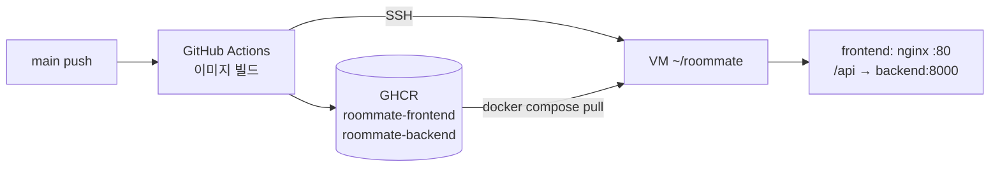

# VM 배포 (Docker)

- `main` 반영 시 [CD 워크플로](../.github/workflows/cd.yml)가 Docker 이미지를 빌드하여 GHCR에 업로드하고, VM에서 `docker compose`로 재기동한다.
- API 키는 VM의 `~/roommate/.env`에만 둔다. GitHub · 이미지 · 저장소에는 포함하지 않는다.

## 구성



| 이미지 | 내용 | 빌드 조건 |
| --- | --- | --- |
| `ghcr.io/gokimkh123/roommate-frontend` | Vite 빌드 결과 + nginx, `/api` 요청을 `backend:8000`으로 프록시 (SSE 버퍼링 해제) | 항상 |
| `ghcr.io/gokimkh123/roommate-backend` | Python 3.12 + `uvicorn app.main:app` (포트 8000), `engine/` · `data/` 포함 | `backend/app/main.py`와 `backend/requirements.txt` 모두 존재 시 |

- 백엔드 서버 코드 준비 전: 프론트엔드만 **목업 모드**(`VITE_USE_MOCK=true`)로 배포
- 백엔드 서버 코드 병합 후: 프론트엔드 실서버 모드 + 백엔드 함께 배포 (별도 설정 불필요)
- 태그: `latest`, 커밋 SHA (롤백 시 SHA 태그 사용)

## 백엔드 서버 코드 조건

- 진입점: `backend/app/main.py`의 FastAPI 인스턴스 `app`
- 의존성: `backend/requirements.txt` (`fastapi`, `uvicorn` 등 런타임 패키지)
- 컨테이너 내 경로: `/srv/backend`(작업 폴더), `/srv/engine`, `/srv/data` → 저장소와 동일한 상대 경로 유지
- DB: `DATABASE_URL=sqlite:////srv/var/roommate.db` (compose에서 지정, 볼륨 `backend-db`에 보존)

## VM 최초 준비 (1회, 건한)

1. Docker Engine 및 Compose 플러그인 설치 (`docker compose version`으로 확인)
2. 배포 계정을 `docker` 그룹에 추가: `sudo usermod -aG docker <계정>` 후 재접속
3. 배포 전용 SSH 키 생성 (로컬, 저장소 폴더 밖): `ssh-keygen -t ed25519 -f ~/.ssh/roommate_deploy -N ""`
4. 공개키(`roommate_deploy.pub`)를 VM 배포 계정의 `~/.ssh/authorized_keys`에 추가
5. VM에 `~/roommate/.env` 작성 (커밋 금지)

```bash
mkdir -p ~/roommate && cd ~/roommate
cat > .env <<'ENV'
WEB_PORT=80
ANTHROPIC_API_KEY=<API 키>
LLM_PROVIDER=anthropic
LLM_MODEL=claude-haiku-5-5
LLM_MAX_CONCURRENCY=8
ENGINE_IMPL=real
SIM_MODE=agents
REPLAY_DELAY_MS=600
ENV
chmod 600 .env
```

6. 방화벽에서 `WEB_PORT`(기본 80) 및 SSH 포트 허용
7. GitHub 저장소 **Settings → Environments → `production` → Environment secrets → Add secret** 등록 (Repository secret 사용 금지: 작업 브랜치 워크플로에서 접근 가능)

| Secret | 값 | 필수 |
| --- | --- | --- |
| `VM_HOST` | VM 공인 IP 또는 도메인 | 필수 |
| `VM_USER` | 배포 계정 이름 | 필수 |
| `VM_SSH_KEY` | 개인키(`roommate_deploy`) 파일 전체 내용 | 필수 |
| `VM_SSH_PORT` | SSH 포트 | 선택 (기본 22) |

- Secrets 미등록 시 CD는 이미지 업로드까지만 수행하고 배포 단계 생략 (경고 표시)
- 등록 후 **Actions → CD → Run workflow**로 수동 배포 가능
- VM이 외부(GitHub Actions)에서 SSH 접속 불가한 사설망인 경우: self-hosted runner 방식으로 전환 필요

## 운영 명령 (VM)

| 목적 | 명령 (`~/roommate`에서) |
| --- | --- |
| 상태 확인 | `docker compose ps` |
| 로그 확인 | `docker compose logs -f backend` |
| 재시작 | `docker compose restart` |
| 롤백 | `docker-compose.yml`의 `:latest`를 이전 커밋 SHA로 변경 후 `docker compose up -d` |
| 중지 | `docker compose down` (DB 볼륨 유지) |
