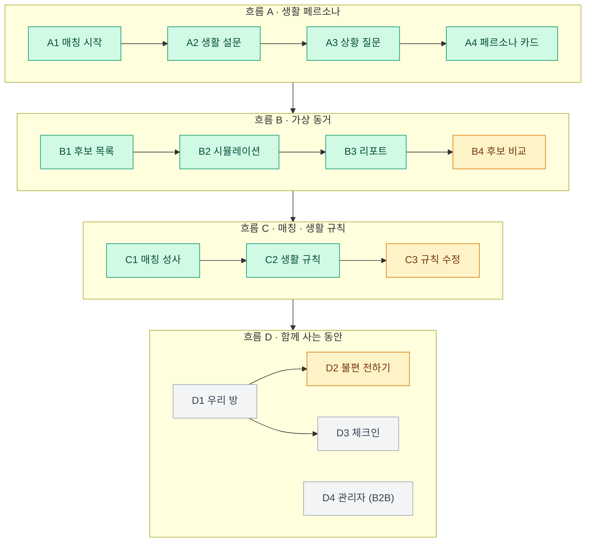
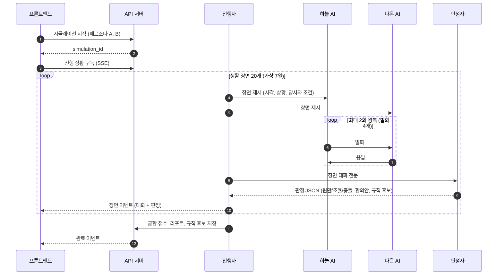
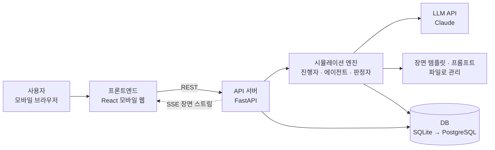
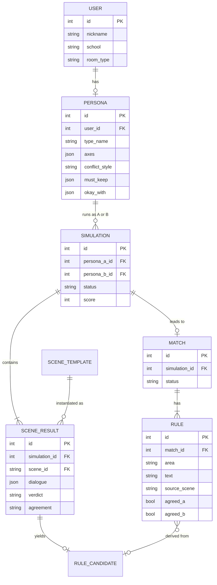
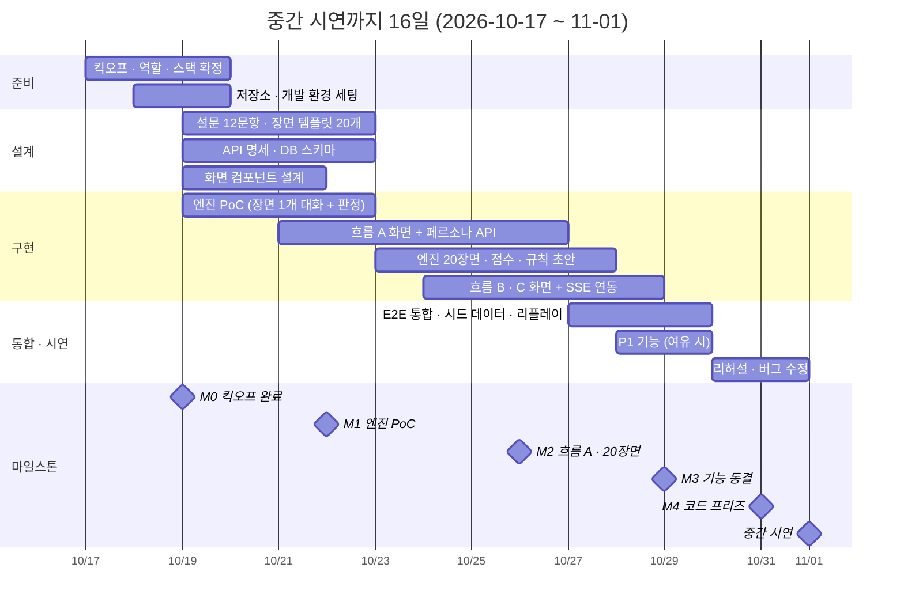
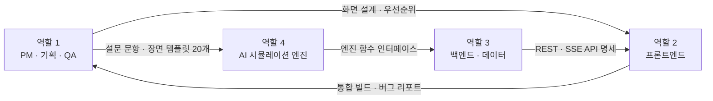

# 룸메궁합 PRD (Product Requirements Document)

> 함께 살기 전, 두 사람의 AI 분신이 가상으로 먼저 살아보고 잘 맞는 룸메이트와 생활 규칙을 제안한다.

| 항목 | 내용 |
| --- | --- |
| 문서 버전 | v1.0 (초안 · 팀 검토용) |
| 작성일 | 2026-10-17 |
| 기반 문서 | [룸메궁합 서비스 기획서 v1.0](../룸메궁합_서비스기획서_v1.0.pdf) (2026-10-13) |
| 과목 | 2026 SW 시스템 설계 및 개발 II |
| 팀 | 4명 (역할 배정은 킥오프 미팅에서 결정) |
| 핵심 마일스톤 | **2026-11-01 중간 개발 완료 및 시연** |

---

## 목차

1. [요약](#1-요약)
2. [배경 및 문제 정의](#2-배경-및-문제-정의)
3. [목표와 성공 지표](#3-목표와-성공-지표)
4. [대상 사용자](#4-대상-사용자)
5. [핵심 개념과 용어](#5-핵심-개념과-용어)
6. [사용자 흐름과 범위](#6-사용자-흐름과-범위)
7. [기능 요구사항](#7-기능-요구사항)
8. [시뮬레이션 엔진 설계](#8-시뮬레이션-엔진-설계)
9. [비기능 요구사항](#9-비기능-요구사항)
10. [기술 스택과 아키텍처](#10-기술-스택과-아키텍처)
11. [일정 (10/17 ~ 11/1)](#11-일정-1017--111)
12. [중간 시연 시나리오](#12-중간-시연-시나리오)
13. [역할 구분 (4개)](#13-역할-구분-4개)
14. [리스크와 대응](#14-리스크와-대응)
15. [오픈 이슈](#15-오픈-이슈)
16. [참고 자료](#16-참고-자료)

---

## 1. 요약

- **무엇을**: 생활 설문과 상황 질문으로 사용자의 **생활 페르소나(AI 분신)** 를 만들고, 후보 룸메이트의 AI와 **가상 7일 · 생활 장면 20개** 를 먼저 살아보게 한다. 그 결과로 **궁합 점수 · 시뮬레이션 리포트 · 생활 규칙 초안** 을 제공하고, 입주 후에는 **AI 중재** 로 갈등을 조기에 푼다.
- **누구를 위해**: 대학 기숙사 2인실 입사생(1차), 코리빙·셰어하우스 입주 청년(2차), 생활관 관리자(B2B, 최종).
- **차별점**: 설문 점수 비교가 아니라 **생활 장면 시뮬레이션으로 궁합을 검증** 하고, 매칭 이후의 **규칙 합의와 중재까지 연결** 한다.
- **11/1 중간 시연 목표**: 흐름 A(페르소나) → B(가상 동거) → C(매칭·생활 규칙)를 **한 번에 이어서 시연** 한다. 흐름 D(입주 후 관리)는 최종 개발 범위다.

---

## 2. 배경 및 문제 정의

### 2.1 시장과 수요 신호

| 지표 | 수치 | 출처 |
| --- | --- | --- |
| 전국 사립대 기숙사 평균 수용률 | 20.8% (수도권 17.8%) | 대학알리미 2025.10 공시 |
| 서울 코리빙 공급 | 7,377실 (2026년 1분기), 연간 투자 1,970억 → 3,850억 원 | 뉴시스 2026.5.27 |
| 대학의 AI 룸메이트 매칭 도입 | 조선대 2026년 봄학기 378명 시범 매칭 | Korea JoongAng Daily 2026.3.24 |
| 갈등 상시 경험 학생 | 5명 중 1명, 이 중 50%가 중도 이탈을 진지하게 고려 (전체 평균 약 25%) | GSL Index |

룸메이트 갈등의 주요 원인 (영국 18~25세 대학생·학부모 4,000명 이상, 복수 응답, Nationwide·Censuswide 2026.8.13)

| 원인 | 비율 |
| --- | --- |
| 소음 | 26% |
| 음식 무단 사용 | 24% |
| 정리·청소 | 22% |
| 과소비 | 20% |
| 금전 대차 | 19% |
| 공과금 | 14% |

### 2.2 해결할 문제

| ID | 문제 | 현재 상황 |
| --- | --- | --- |
| P1 | 함께 살기 전 궁합을 확인할 수 없다 | 설문 점수 비교로는 "새벽 통화", "친구 초대" 같은 실제 장면에서의 반응을 예측하지 못한다 |
| P2 | 생활 규칙이 없다 | 입주 초기에 규칙 합의 없이 생활을 시작하고, 갈등이 생긴 뒤에야 기준 차이를 안다 |
| P3 | 갈등을 표현하고 중재할 수단이 부족하다 | 직접 말하기 부담으로 불만이 쌓이고, 관리자 중재는 민원 접수 후 사후 대응 위주다 |

### 2.3 기존 방식과의 비교

| 서비스·방식 | 제공 기능 | 한계 |
| --- | --- | --- |
| 대학 생활관 배정 (다수) | 무작위·선착순·학과 기준 배정 | 생활 습관 미반영 |
| 조선대 AI 매칭 (2026 시범) | 생활 습관 설문 기반 자동 매칭 | 실제 상황 반응·대화 방식 미반영 |
| Roome · RoomSync (해외) | 선호도 기반 매칭, 공과금 분할 | 국내 미지원, 입주 후 관리 부재 |
| 커뮤니티 게시판 | 자기소개 글 기반 개인 탐색 | 검증·매칭 기능 부재 |

### 2.4 기술 근거

Stanford·Google 연구(Park et al., 2024)는 1,052명의 인터뷰·설문 데이터로 개인별 생성형 에이전트를 만들고 응답 재현도를 측정했다. 인터뷰+설문 결합 시 **86%** (설문만 82%, 인구통계만 74%)로, 생활 설문과 상황 질문을 결합한 페르소나 설계의 근거가 된다. 단, 시뮬레이션 결과는 **예측치** 이며 최종 선택은 당사자가 한다.

---

## 3. 목표와 성공 지표

### 3.1 중간 시연(11/1) 목표

| ID | 목표 |
| --- | --- |
| G1 | 12문항 응답으로 3분 안에 생활 페르소나 카드를 만든다 |
| G2 | 두 페르소나가 생활 장면 20개를 실제 LLM 대화로 시뮬레이션하고, 장면마다 원만·조율·충돌을 판정한다 |
| G3 | 시뮬레이션 결과로 궁합 점수, 리포트, 생활 규칙 초안(6개 영역)을 자동 생성한다 |
| G4 | 페르소나 생성부터 생활 규칙 동의까지 한 사용자 흐름으로 끊김 없이 시연한다 |

### 3.2 중간 시연 범위 밖 (Non-goals)

- 실제 학교 메일 인증, 실사용자 간 매칭(시연은 시드 후보 사용)
- 흐름 D의 우리 방·체크인·관리자 화면, 공용품 정산, 학사 일정 연동
- 결제·수익 모델 구현, 네이티브 앱 배포

### 3.3 성공 지표

**중간 시연 기준 (개발팀이 11/1까지 확인할 지표)**

| 지표 | 목표 |
| --- | --- |
| 시연 시나리오 완주 | 리허설 3회 연속 무중단 완주 |
| 페르소나 생성 소요 시간 | 12문항 응답 ≤ 3분, 응답 완료 → 카드 표시 ≤ 10초 |
| 시뮬레이션 소요 시간 | 후보 1명 20장면 ≤ 3분 (후보 3명 병렬 실행) |
| 판정 출력 형식 | 장면 판정 JSON 스키마 통과율 100% |
| 판정 일관성 | 같은 페르소나 쌍 3회 재실행 시 궁합 점수 편차 ±10 이내 |
| 규칙 초안 | 6개 영역 모두 생성, 각 규칙에 출처 장면 표시 |

**서비스 지표 (출시 후, 기획서 기준)**

| 지표 | 목표 |
| --- | --- |
| 재배정 요청 | 30% 감소 (시범 도입 대학 기준) |
| 매칭 수락률 | 측정 후 목표 설정 |
| 생활 지수 | 측정 후 목표 설정 |

---

## 4. 대상 사용자

| 구분 | 대상 | 핵심 니즈 | 단계 |
| --- | --- | --- | --- |
| 1차 사용자 | 대학 기숙사 2인실 신입 입사생 | 나와 생활 리듬이 맞는 룸메이트, 처음부터 정해진 생활 규칙 | 중간 시연 |
| 2차 사용자 | 코리빙·셰어하우스 입주 청년 | 입주자 간 분쟁 예방과 정산 | 최종 이후 |
| B2B 고객 | 대학 생활관 관리자 | 재배정 민원 감소, 위험 호실 조기 파악 (대화 내용은 비공개) | 최종 |

**시연용 예시 인물 (기획서 기준, 시드 데이터로 사용)**

| 인물 | 유형 | 역할 | 특징 |
| --- | --- | --- | --- |
| 하늘 | 규칙적인 아침형 | 나 (시연 사용자) | 23시 취침 · 6시 반 기상, 불편하면 바로·부드럽게 말함. 꼭 지켜줘: 24시 이후 통화·게임 소리 X |
| 수빈 | 자유로운 올빼미 | 후보 A | 경영학과 1학년, 수면 리듬 차이 큼 |
| 다은 | 깔끔한 집순이 | 후보 B | 간호학과 1학년, 청결 기준 비슷, 실습 주간에 일찍 잠 |
| 지호 | 조용한 독서가 | 후보 C | 컴퓨터공학과 1학년, 소음 민감도 비슷 |

---

## 5. 핵심 개념과 용어

| 용어 | 정의 |
| --- | --- |
| 생활 페르소나 | 설문·상황 질문 응답으로 만든 사용자의 생활 프로필. 5개 축 점수, 유형명, 대화 방식, 꼭 지켜줘·괜찮아요 항목을 가진다 |
| AI 분신 | 생활 페르소나를 시스템 프롬프트로 가진 LLM 에이전트. 시뮬레이션에서 사용자처럼 말한다 |
| 5개 축 | 수면 리듬(아침형↔올빼미) · 청결 · 소음 민감 · 사교성 · 공유 관대 |
| 대화 방식 | 상황 질문 응답에서 추출한 갈등 대응 스타일: 직설 · 회피 · 지연 |
| 가상 동거 | 두 AI 분신이 가상 7일 동안 생활 장면 20개를 함께 겪는 시뮬레이션 |
| 생활 장면 | 갈등 유형 기반 상황 템플릿 (예: 3일차 수요일 01:10, 심야 게임) |
| 판정 | 장면 결과 분류. **원만**: 이견 없음 · **조율**: 이견이 있었으나 대화로 합의 · **충돌**: 합의 실패, 판정자가 합의안 제안 |
| 궁합 점수 | 장면 판정 분포로 계산한 0~100 점수 (참고 정보, 매칭은 양측 수락으로 성립) |
| 생활 규칙 | 시뮬레이션 합의를 6개 영역(조용한 시간 · 친구 초대 · 청소 · 냉장고 · 냉난방 · 공용품)으로 정리한 규칙 |
| AI 중재자 | 규칙 수정 제안이나 불편 메모를 두 페르소나 기준으로 검토해 중재안·요청형 문장을 만드는 LLM 기능 |
| 생활 지수 | 규칙 이행률과 체크인으로 계산한 방 단위 지표 (최종 범위) |

---

## 6. 사용자 흐름과 범위

### 6.1 전체 흐름

4개 탭(우리 방 · 매칭 · 페르소나 · 전체), 4개 핵심 흐름, 화면 15개로 구성한다. 색은 11/1 중간 시연 우선순위다.



| 색 | 우선순위 | 의미 |
| --- | --- | --- |
| 초록 | **P0** | 11/1 중간 시연 필수 |
| 노랑 | **P1** | 10/29 기능 동결 전에 여유가 있으면 포함 |
| 회색 | **P2** | 최종 개발 범위 |


### 6.2 화면별 범위

| ID | 화면 | 우선순위 | 중간 시연 구현 수준 |
| --- | --- | --- | --- |
| A1 | 매칭 시작 | P0 | 생활관·호실 유형·마감일은 고정 데이터. 학교 메일 인증은 목업 |
| A2 | 생활 설문 | P0 | 취침·기상 슬라이더, 4단계 선택형, 시험 기간 토글 |
| A3 | 상황 질문 | P0 | 갈등 장면 + 선택지 4개, 대화 방식 추출 |
| A4 | 페르소나 카드 | P0 | 유형명·요약·5개 축 막대·꼭 지켜줘/괜찮아요 |
| B1 | 후보 목록 | P0 | 시드 후보 풀에서 상위 3명 추림, 익명 표시, 진행 상태·점수 |
| B2 | 시뮬레이션 | P0 | 장면 진행 막대, 대화 실시간 표시, 규칙 후보 저장 알림 |
| B3 | 리포트 | P0 | 궁합 점수, 한 줄 판정, 원만·조율·충돌 분포, 부딪힌 장면과 합의안 |
| B4 | 후보 비교 | P1 | 5개 축 레이더 차트, 점수, 월 예상 갈등 횟수 |
| C1 | 매칭 성사 | P0 | 룸메 신청 → 시드 후보 자동 수락 → 이름 공개 |
| C2 | 생활 규칙 | P0 | 6개 영역 초안, 출처 장면 표시, 동의하기 |
| C3 | 규칙 수정 | P1 | 수정 제안 → AI 중재안 → 수락 |
| D1 | 우리 방 | P2 | 생활 지수, 이번 주 할 일, 공용품 정산 |
| D2 | 불편 전하기 | P1 | 나만 보는 메모 → 요청형 문장 변환 → 확인 후 전송 |
| D3 | 체크인 | P2 | 월 1회 만족도, 규칙 이행률, 지수 추이 |
| D4 | 관리자 | P2 | 생활관 평균 지수, 중재·재배정 현황, 위험 호실 |
| - | 알림 · 학교 인증 · 개인정보 · 고객센터 | P2 | 전체 탭 |

---

## 7. 기능 요구사항

우선순위: **P0** = 11/1 필수 · **P1** = 여유 시 · **P2** = 최종

### 7.1 흐름 A · 생활 페르소나

| ID | 요구사항 | 우선순위 | 완료 기준 |
| --- | --- | --- | --- |
| FR-A1 | 매칭 시작 화면에 학교 인증 상태, 배정 정보(호실 유형·동), 매칭 마감일을 보여 주고 가상 동거 방식을 안내한다 | P0 | 고정 데이터로 표시, "생활 페르소나 만들기" 버튼으로 A2 진입 |
| FR-A2 | 생활 설문: 평일 취침·기상 시각(슬라이더), 소음 민감도 등 4단계 선택형 문항, 시험 기간 생활 변화 여부를 받는다 | P0 | 진행률(n/12) 표시, 응답이 서버에 저장됨 |
| FR-A3 | 상황 질문: 실제 갈등 장면을 제시하고 대응 방식 4개 중 하나를 고른다. "정답 없음"을 안내한다 | P0 | 응답이 대화 방식(직설·회피·지연)으로 매핑되어 저장됨 |
| FR-A4 | 페르소나 생성: 응답으로 5개 축 점수(0~100)를 규칙 기반으로 계산하고, LLM으로 유형명과 두 줄 요약을 만든다 | P0 | 응답 완료 후 10초 안에 카드 표시 |
| FR-A5 | "꼭 지켜줘"(필수 조건)와 "괜찮아요"(허용 조건)를 등록·수정한다. 꼭 지켜줘는 시뮬레이션에서 필수 조건으로 쓰인다 | P0 | 카드에 표시되고 에이전트 프롬프트에 반영됨 |
| FR-A6 | 페르소나 카드 수정 (축 값, 요약 문구) | P2 | - |

### 7.2 흐름 B · 가상 동거

| ID | 요구사항 | 우선순위 | 완료 기준 |
| --- | --- | --- | --- |
| FR-B1 | 설문 점수로 후보 풀에서 상위 3명을 1차 추림한다 (5개 축 거리 + 꼭 지켜줘 위반 감점) | P0 | 시드 후보 풀 10명 중 3명 반환 |
| FR-B2 | 매칭 전 후보는 익명으로 표시한다 (학과·학년·유형만 공개, 이름·사진 비공개) | P0 | 후보 카드에 이름 대신 "후보 A/B/C" |
| FR-B3 | 후보별 시뮬레이션을 자동 실행한다: 가상 7일 · 장면 20개, 장면별 대화 → 조율 → 판정 | P0 | 3명 병렬 실행, 후보 1명 ≤ 3분 |
| FR-B4 | 시뮬레이션 화면에 장면 진행 막대(원만·조율·충돌 색 구분), 장면 정보(시각·상황·당사자 조건), 두 AI의 대화를 실시간으로 보여 준다 | P0 | 장면이 끝날 때마다 화면 갱신 (SSE) |
| FR-B5 | 조율 성공 시 규칙 후보를 자동 저장하고 화면에 알린다. 이전 장면의 미해결 항목을 누적 표시한다 | P0 | "규칙 후보 저장" 배지, "조율 필요" 목록 |
| FR-B6 | 리포트: 궁합 점수, 한 줄 판정, 장면 20개의 판정 분포, 부딪힌 장면별 합의안, 대화 다시 보기 | P0 | 기획서 B3 화면 구성과 같음 |
| FR-B7 | 후보 비교: 나와 후보들의 5개 축 레이더 차트, 궁합 점수, 월 예상 갈등 횟수, 룸메 신청 버튼 | P1 | 후보 3명 동시 비교 |

### 7.3 흐름 C · 매칭 · 생활 규칙

| ID | 요구사항 | 우선순위 | 완료 기준 |
| --- | --- | --- | --- |
| FR-C1 | 룸메 신청 후 양측이 수락하면 매칭이 성립하고 이름과 호실 배정 예정 정보를 공개한다 | P0 | 시연에서는 시드 후보가 자동 수락 |
| FR-C2 | 상대의 첫인사 메시지를 보여 준다 | P1 | 시드 데이터 문구 |
| FR-C3 | 생활 규칙 초안: 시뮬레이션 규칙 후보를 6개 영역으로 정리하고, 규칙마다 출처 장면(예: 5일차 충돌)을 표시한다 | P0 | 6개 영역 모두 채워짐 |
| FR-C4 | 양측이 동의하면 규칙을 확정한다 | P0 | 동의 상태(나 ✓ / 상대 확인 대기) 표시 |
| FR-C5 | 규칙 수정 제안 → AI 중재자가 두 페르소나 기준으로 검토 → 중재안 제시 → 수락 또는 다르게 제안 | P1 | 중재안과 근거 2개 표시 |
| FR-C6 | 학사 일정 연동으로 시험 기간을 자동 감지해 규칙을 바꿔 적용한다 | P2 | - |

### 7.4 흐름 D · 함께 사는 동안

| ID | 요구사항 | 우선순위 | 완료 기준 |
| --- | --- | --- | --- |
| FR-D1 | 불편 전하기: 본인만 보는 메모를 AI가 요청형 문장으로 바꾸고, 재발 방지 규칙 개선안을 함께 제시한다. 사용자가 확인한 뒤에만 전송한다 | P1 | 메모 원문은 상대에게 전달되지 않음 |
| FR-D2 | 우리 방: 생활 지수, 이번 주 할 일(청소 당번 등), 공용품 구매 차례와 영수증 정산, 오늘의 조용한 시간 | P2 | - |
| FR-D3 | 월 1회 체크인: 만족도, 규칙 영역별 이행률, 생활 지수 월별 추이 | P2 | - |
| FR-D4 | 관리자 화면: 평균 생활 지수, 중재 진행·재배정 요청 수, 위험 호실 우선 표시. 대화 내용은 보이지 않고 집계만 제공 | P2 | - |

---

## 8. 시뮬레이션 엔진 설계

서비스의 핵심이자 중간 시연의 가장 큰 기술 리스크다. 엔진은 웹 서버와 분리된 모듈로 만들어 CLI로도 단독 실행할 수 있게 한다.

### 8.1 실행 흐름



### 8.2 생활 장면 20개

국내 기숙사·셰어하우스 갈등 유형을 바탕으로 기획서에서 정한 장면이다. 각 장면의 일차·시각 배치는 오픈 이슈다.

| 카테고리 | 장면 | 개수 | 연결되는 규칙 영역 |
| --- | --- | --- | --- |
| 수면·소음 | 새벽 통화, 심야 게임, 이른 알람, 드라이기 소음 | 4 | 조용한 시간 |
| 청결·청소 | 설거지 미루기, 욕실 머리카락, 청소 당번 | 3 | 청소 |
| 공용 물품 | 냉장고 반찬, 휴지·세제 소진, 물건 무단 사용, 공과금 분담 | 4 | 냉장고, 공용품 |
| 방문객 | 친구 초대, 연인 방문, 늦은 귀가 | 3 | 친구 초대 |
| 환경 | 난방 온도, 환기, 조명 | 3 | 냉난방 |
| 특수 기간 | 시험 기간, 실습 주간, 주말 늦잠 | 3 | 조용한 시간, 청소 |

### 8.3 데이터 형식 (초안)

**페르소나**

```json
{
  "nickname": "하늘",
  "type_name": "규칙적인 아침형",
  "summary": "23시 취침 · 6시 반 기상. 불편하면 바로, 부드럽게 말하는 편.",
  "sleep": { "bedtime": "23:00", "wake": "06:30", "exam_period_changes": true },
  "axes": {
    "sleep_rhythm": 15,
    "cleanliness": 85,
    "noise_sensitivity": 80,
    "sociability": 50,
    "sharing_tolerance": 30
  },
  "conflict_style": "direct",
  "must_keep": ["24시 이후 통화·게임 소리 X"],
  "okay_with": ["친구 초대 (미리 말하면)"]
}
```

- `axes`는 0~100. `sleep_rhythm`은 0 = 아침형, 100 = 올빼미.
- `conflict_style`은 `direct`(직설) · `avoid`(회피) · `delay`(지연).

**장면 템플릿**

```json
{
  "id": "S09",
  "category": "수면·소음",
  "title": "심야 게임",
  "day": 3,
  "time": "01:10",
  "situation": "{B}가 친구와 음성 채팅으로 게임 중, {A}는 내일 9시 수업",
  "rule_area": "조용한 시간",
  "related_axes": ["sleep_rhythm", "noise_sensitivity"]
}
```

**판정 결과** (구조화 출력으로 스키마를 강제)

```json
{
  "scene_id": "S09",
  "verdict": "조율",
  "reason": "소음 기준 차이가 있었으나 헤드셋 사용으로 합의",
  "agreement": "평일 24시 이후 헤드셋, 금·토는 1시까지",
  "rule_candidate": { "area": "조용한 시간", "text": "평일 24시 이후 헤드셋 사용" },
  "unresolved": null
}
```

### 8.4 궁합 점수 (초기 산식)

```text
궁합 점수 = round(100 × (원만 수 + 0.5 × 조율 수) / 20)
```

기획서 예시(원만 16 · 조율 3 · 충돌 1)를 넣으면 87.5 → **88점** 으로 기획서 리포트 화면과 같다. 설문 유사도를 함께 반영할지, 월 예상 갈등 횟수를 어떻게 계산할지는 오픈 이슈다.

### 8.5 비용과 안정성

| 항목 | 설계 |
| --- | --- |
| LLM 호출량 | 장면 1개 = 발화 4회 + 판정 1회 = 5회 → 후보 1명 100회 → 사용자 1명(후보 3명) 약 300회 |
| 호출량 줄이기 | 설문 1차 추림으로 후보 3명 제한, 장면 템플릿과 페르소나 프롬프트 재사용(프롬프트 캐싱), 시드 후보끼리의 결과는 미리 생성 |
| 속도 | 후보 3명 병렬 실행, 장면 단위로 결과를 즉시 스트리밍 |
| 실패 처리 | 호출 실패 시 2회 재시도, 그래도 실패하면 해당 장면은 "판정 보류"로 두고 다음 장면 진행 |
| 시연 안전장치 | **리플레이 모드**: 미리 생성해 둔 시뮬레이션 결과를 실시간처럼 재생. 네트워크·API 문제가 생겨도 시연이 이어지게 한다 |
| 품질 확인 | 골든 페어 2쌍(하늘-수빈: 수면 충돌 많음, 하늘-다은: 원만)으로 프롬프트를 바꿀 때마다 회귀 확인 |
| 안전 | 에이전트 프롬프트에 비하·혐오 표현 금지, 성별·출신 지역 등 민감 정보는 매칭 기준에서 제외 |

---

## 9. 비기능 요구사항

| 분류 | 요구사항 |
| --- | --- |
| 성능 | 페르소나 카드 생성 ≤ 10초, 장면 1개 처리 ≤ 10초, 후보 1명 20장면 ≤ 3분 |
| 사용성 | 모바일 우선 (390 × 844 기준), 하단 4탭, 기획서 목업과 같은 화면 구성 |
| 개인정보 | 매칭 전 익명(학과·학년·유형만), 관리자에게는 집계만 제공, 대화 원문은 단기 보관 후 요약만 유지(최종). 시연은 가상 인물 데이터만 사용 |
| 공정성 | 성별·출신 지역 등 민감 정보는 매칭 기준에서 제외. 궁합 점수는 참고 정보임을 화면에 표시 |
| AI 한계 고지 | 시뮬레이션 결과는 예측치임을 안내하고, 매칭은 양측 수락으로만 성립 |
| 보안 | LLM API 키는 서버 환경변수로만 관리하고 저장소에 커밋하지 않는다 (`.env`는 `.gitignore`에 포함) |
| 유지보수 | 프롬프트와 장면 템플릿은 코드와 분리된 파일로 관리해 비개발 역할도 수정할 수 있게 한다 |

---

## 10. 기술 스택과 아키텍처

> 아래는 2주 일정에 맞춘 **제안** 이다. 킥오프 미팅에서 확정한다.

### 10.1 시스템 구성



### 10.2 기술 스택 제안

| 영역 | 제안 | 이유 |
| --- | --- | --- |
| 프론트엔드 | React + TypeScript + Vite, Tailwind CSS, Recharts(레이더 차트) | 모바일 웹으로 빠르게 구현, 기획서 목업을 그대로 옮기기 쉬움. 네이티브 앱은 2주 안에 위험 |
| 백엔드 | Python FastAPI | LLM SDK·비동기 병렬 호출·SSE 지원이 간단 |
| DB | SQLite (중간 시연) → PostgreSQL (최종) | 시연은 설치 부담 없이, 최종은 다중 사용자 대응 |
| LLM | Claude API (Python SDK). 기본 모델 `claude-opus-5-5` | 페르소나 일관성과 판정 품질 우선. 기획서의 비용 대응안대로 에이전트 발화는 `claude-haiku-5-5`로 바꿔 품질·비용을 비교한 뒤 결정 |
| 실시간 | SSE (Server-Sent Events) | 서버 → 클라이언트 단방향 장면 스트리밍에 충분 |
| 배포 | 프론트 Vercel, 백엔드 Render 또는 Railway (시연은 로컬 실행도 가능) | 무료 티어로 시연 가능 |
| 협업 | GitHub Issues · Projects, PR 리뷰 1인 이상 | 진행 상황과 리뷰 이력 공유 |

### 10.3 데이터 모델 (초안)



### 10.4 API 초안

| 메서드 | 경로 | 설명 | 우선순위 |
| --- | --- | --- | --- |
| POST | `/personas` | 설문·상황 질문 응답 → 페르소나 생성 | P0 |
| GET | `/personas/{id}` | 페르소나 카드 조회 | P0 |
| PATCH | `/personas/{id}` | 꼭 지켜줘·괜찮아요 수정 | P0 |
| GET | `/candidates?persona_id=` | 1차 추림 상위 3명 | P0 |
| POST | `/simulations` | 시뮬레이션 시작 (페르소나 A, B) | P0 |
| GET | `/simulations/{id}/stream` | 장면 이벤트 스트림 (SSE) | P0 |
| GET | `/simulations/{id}/report` | 리포트 조회 | P0 |
| POST | `/matches` | 룸메 신청 | P0 |
| POST | `/matches/{id}/accept` | 신청 수락 (시연은 자동) | P0 |
| GET | `/matches/{id}/rules` | 생활 규칙 초안 조회 | P0 |
| POST | `/rules/{id}/agree` | 규칙 동의 | P0 |
| POST | `/rules/{id}/proposals` | 규칙 수정 제안 → AI 중재안 | P1 |
| POST | `/mediation/rephrase` | 불편 메모 → 요청형 문장 | P1 |

### 10.5 저장소 구조 (제안)

```text
SW_Design_Development/
├── README.md
├── LICENSE
├── docs/              # PRD, API 명세, 회의록, 이미지
├── frontend/          # React 모바일 웹
├── backend/
│   ├── app/           # FastAPI (라우터, 모델, 서비스)
│   └── engine/        # 시뮬레이션 엔진 (진행자, 에이전트, 판정자)
│       ├── prompts/   # 페르소나·판정·중재 프롬프트
│       └── scenes/    # 생활 장면 템플릿 20개
└── data/seed/         # 시드 페르소나 (하늘, 수빈, 다은, 지호 외)
```

---

## 11. 일정 (10/17 ~ 11/1)

오늘(10/17)부터 중간 시연(11/1)까지 16일이다. **10/29에 기능을 동결** 하고 마지막 이틀은 리허설과 버그 수정에만 쓴다.



| 마일스톤 | 날짜 | 완료 기준 |
| --- | --- | --- |
| M0 킥오프 완료 | 10/19 (월) | 역할 4개 배정, 기술 스택·LLM 모델 확정, 저장소에 frontend/backend 뼈대 커밋 |
| M1 엔진 PoC | 10/22 (목) | CLI에서 페르소나 2개로 장면 1개 대화 + 판정 JSON 출력. API 명세 확정(이후 변경은 합의 필요) |
| M2 흐름 A · 20장면 | 10/26 (월) | 흐름 A 화면에서 페르소나 카드 생성. 엔진이 20장면을 끝까지 돌고 점수 산출 |
| M3 기능 동결 | 10/29 (목) | A → B → C 한 흐름으로 연결. 이후에는 버그 수정과 P1 마무리만 |
| M4 코드 프리즈 | 10/31 (토) | 리허설 3회 연속 무중단 완주, 리플레이 모드 준비, 시연 버전 태그 |
| 중간 시연 | 11/1 (일) | 중간 개발 완료 |

**운영 규칙**

- 매일 10분 온라인 스탠드업 (어제 한 일 · 오늘 할 일 · 막힌 점)
- `main` 브랜치는 보호하고 기능 브랜치(`feature/...`) → PR → 1인 이상 리뷰 후 병합
- 프론트엔드는 M1의 API 명세로 목(mock) 응답을 만들어 백엔드와 병렬로 개발

---

## 12. 중간 시연 시나리오

예상 5~7분. 아래 숫자는 기획서 목업 기준이며, 실제 값은 엔진 결과로 나온다.

1. **매칭 시작** — 신입생 하늘(시드 계정)로 ○○대 생활관 2인실 매칭을 시작한다.
2. **생활 페르소나** — 설문 12문항에 답하고 "규칙적인 아침형" 카드를 받는다. 꼭 지켜줘: 24시 이후 통화·게임 소리 X.
3. **후보 목록** — 후보 3명(올빼미 71점 · 집순이 88점 · 독서가 84점)이 익명으로 표시된다.
4. **가상 동거 (라이브)** — 후보 A(수빈)와의 시뮬레이션을 실시간으로 본다. 3일차 01:10 심야 게임 장면에서 두 AI가 "평일 24시 이후 헤드셋"으로 조율한다.
5. **리포트** — 후보 B(다은): 원만 16 · 조율 3 · 충돌 1, 88점. 5일차 냉장고 반찬 충돌의 합의안을 확인한다. (P1: 레이더 차트 비교)
6. **매칭 · 생활 규칙** — 다은에게 신청 → 수락 → 302호 생활 규칙 6개 초안을 확인하고 동의한다.
7. **(P1) 불편 전하기** — "알람 때문에 나도 깨… 짜증나" 메모를 요청형 문장과 규칙 개선안으로 바꿔 보여 준다.

시연 중 API 지연이 생기면 4번은 리플레이 모드로 전환한다.

---

## 13. 역할 구분 (4개)

> 누가 어떤 역할을 맡을지는 킥오프 미팅에서 정한다. 역할마다 **백업 담당 1명** 을 함께 정해 한 사람이 막혀도 진행되게 한다.

### 13.1 역할 간 연결



### 13.2 역할별 책임

| 역할 | 핵심 책임 | 11/1까지 산출물 | 필요 역량 |
| --- | --- | --- | --- |
| **1. PM · 기획 · QA** | 일정·이슈 관리, 우선순위 결정, 설문 12문항과 상황 질문 문구, 생활 장면 20개 시나리오 작성, 시연 시나리오·발표 자료, 통합 테스트 | PRD 최신화, 장면 템플릿 20개, 설문 문항 확정본, 테스트 체크리스트, 시연 대본·발표 자료 | 기획·문서화, 일정 관리, 꼼꼼한 테스트 |
| **2. 프론트엔드** | 모바일 웹 화면 구현(흐름 A~C), 기획서 목업 기반 공통 컴포넌트, 시뮬레이션 실시간 화면(SSE), 리포트·레이더 차트 | 화면 9개(P0) + P1 화면, 공통 UI 컴포넌트, API 연동 | React · TypeScript, CSS, 비동기 처리 |
| **3. 백엔드 · 데이터** | API 서버, DB 스키마, 후보 1차 추림 로직, 매칭·규칙 도메인 로직, 시드 데이터, 배포 | API 명세서, P0 API 11개, 시드 후보 풀 10명, 배포 환경(또는 로컬 실행 스크립트) | Python · FastAPI, DB 설계, REST 설계 |
| **4. AI 시뮬레이션 엔진** | 페르소나 생성 프롬프트, 에이전트 대화 루프, 판정자(구조화 출력), 궁합 점수 산식, 규칙 초안 생성, 비용·지연 최적화, 리플레이 모드 | 엔진 모듈(CLI 실행 가능), 프롬프트 세트, 골든 페어 회귀 결과, 사전 생성 시뮬레이션 데이터 | Python, LLM API, 프롬프트 설계, 비동기 병렬 처리 |

### 13.3 역할 배정 때 확인할 것

- [ ] 각자 해 본 기술과 하고 싶은 역할
- [ ] 역할별 백업 담당 1명
- [ ] 역할 1(PM)도 화면 일부 또는 테스트 코드를 맡을지 여부
- [ ] 역할 3과 4의 경계: 엔진은 순수 Python 모듈, API 서버는 엔진을 호출만 한다
- [ ] 스탠드업 시간과 오프라인 회의 요일

---

## 14. 리스크와 대응

| 리스크 | 영향 | 대응 |
| --- | --- | --- |
| LLM 응답 지연·실패로 시연이 멈춤 | 높음 | 리플레이 모드, 시드 후보 결과 사전 생성, 타임아웃·재시도 |
| 대화가 페르소나를 반영하지 못하거나 판정이 들쑥날쑥함 | 높음 | 판정 기준 루브릭을 프롬프트에 명시, 구조화 출력, 골든 페어로 회귀 확인 |
| 2주 안에 범위를 다 못 끝냄 | 높음 | P0 고정, 10/29 기능 동결 후 P1은 과감히 제외 |
| 프론트·백엔드 통합 지연 | 중간 | 10/22 API 명세 확정, 목 응답으로 병렬 개발, 10/27부터 매일 통합 빌드 |
| API 비용 초과 | 중간 | 후보 3명 제한, 프롬프트 캐싱, 개발 중에는 장면 수를 줄여 테스트, 소형 모델 비교 |
| 개인정보·윤리 문제 제기 | 낮음 | 시연은 가상 인물만 사용, 민감 정보 매칭 기준 제외, 점수는 참고 정보임을 명시 |

---

## 15. 오픈 이슈

킥오프 미팅(10/19 이전)에서 정할 것

- [ ] 역할 4개 배정과 백업 담당
- [ ] 기술 스택 확정 (React + FastAPI 제안안 그대로 갈지)
- [ ] LLM 모델과 API 비용 부담 방식 (`claude-opus-5-5` 기본, 에이전트 발화를 `claude-haiku-5-5`로 바꿀지)
- [ ] 설문 문항 수: 기획서 p.3은 "생활 설문 12문항 + 상황 질문", p.5 화면은 "설문 8문항 + 상황 질문 = 총 12문항". 이 PRD는 **총 12문항(설문 8 + 상황 4)** 으로 가정
- [ ] 생활 장면 20개의 일차·시각 배치 (기획서에는 장면 7 친구 초대와 7일차 친구 초대 규칙이 함께 나옴)
- [ ] 장면당 발화 수 (기본 4개)
- [ ] 궁합 점수에 설문 유사도를 반영할지, 월 예상 갈등 횟수 산식
- [ ] 시연 방식 (라이브 + 리플레이 백업), 시연 기기와 화면 공유 방법
- [ ] 서비스명 확정 (현재 가칭 "룸메궁합")

---

## 16. 참고 자료

- [룸메궁합 서비스 기획서 v1.0 (PDF)](../룸메궁합_서비스기획서_v1.0.pdf)
- Park, J. S. et al. (2024). *Generative Agent Simulations of 1,000 People*. [arXiv:2411.10109](https://arxiv.org/abs/2411.10109)
- 기획서 인용 출처: 대학알리미 2025.10 공시(대학저널 2025.11.4), 뉴시스 2026.5.27(알스퀘어 보고서), Nationwide·Censuswide 조사 2026.8.13, GSL Index, Korea JoongAng Daily 2026.3.24, mwm.ai Roome, RoomSync, StarRez
