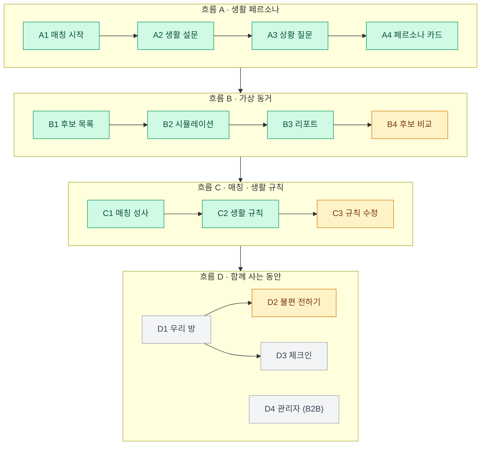
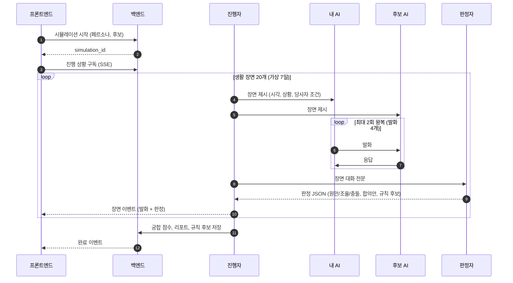
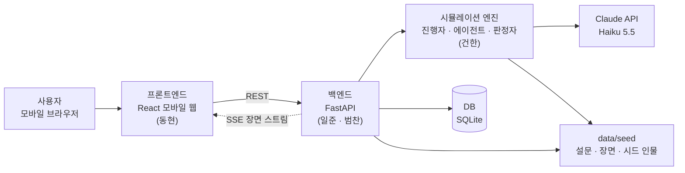
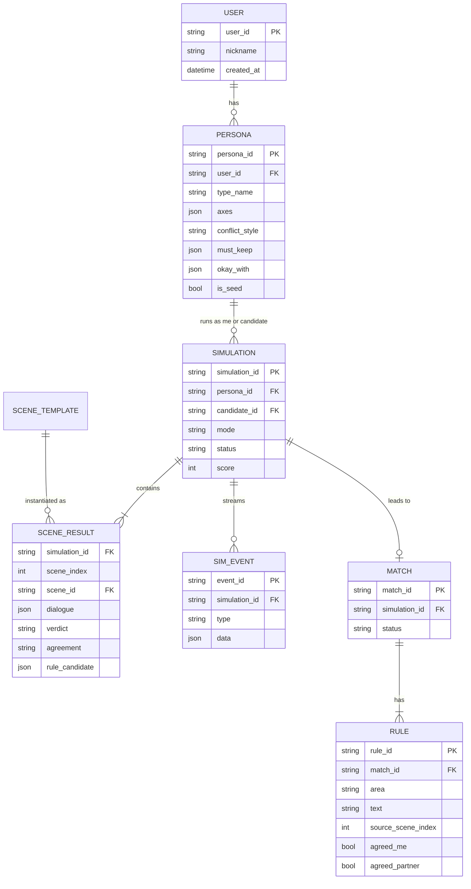
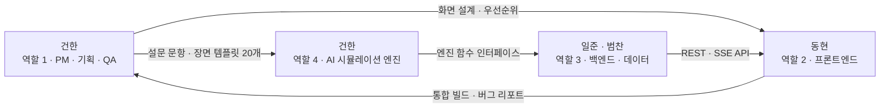

# 룸메궁합 PRD (Product Requirements Document)

> 함께 살기 전, 두 사람의 AI 분신이 가상으로 먼저 살아보고 잘 맞는 룸메이트와 생활 규칙을 제안한다.

| 항목 | 내용 |
| --- | --- |
| 문서 버전 | v1.1 (2026-10-19) · 역할, 일정, LLM 확정 반영 |
| 기반 문서 | [룸메궁합 서비스 기획서 v1.0](../룸메궁합_서비스기획서_v1.0.pdf) (2026-10-13) |
| 과목 | 2026 SW 시스템 설계 및 개발 II |
| 팀 | 건한(PM · AI 엔진) · 동현(프론트엔드) · 일준 · 범찬(백엔드) |
| 함께 보는 문서 | [API 명세서](API.md) · [일정 · 간트 차트](SCHEDULE.md) · [협업 가이드](../CONTRIBUTING.md) |

### 핵심 일정

| 날짜 | 내용 |
| --- | --- |
| 10/20(화) ~ 10/26(월) | 중간고사 기간 (수업 없음). 개발 없이 문서 · 콘텐츠 · 포스터만 준비 |
| **10/26(월) 23:59** | 발표 포스터 제출 (PPTX, 팀 대표 1명) |
| **10/27(화)** | 개발 시작 |
| **11/1(일)** | 개발 마감 · 기능 동결 |
| 11/2(월) | 리허설 · 버그 수정 · 코드 프리즈 |
| **11/3(화) 10:00 ~ 15:00** | AI·SW 신기술 전공 프로젝트 발표회 (부스 시연, 중간고사 대체 평가) |

---

## 목차

1. [요약](#1-요약)
2. [배경 및 문제 정의](#2-배경-및-문제-정의)
3. [목표와 성공 지표](#3-목표와-성공-지표)
4. [대상 사용자](#4-대상-사용자)
5. [핵심 개념과 용어](#5-핵심-개념과-용어)
6. [사용자 흐름과 범위](#6-사용자-흐름과-범위)
7. [기능 요구사항](#7-기능-요구사항)
8. [시뮬레이션 엔진 설계](#8-시뮬레이션-엔진-설계)
9. [비기능 요구사항](#9-비기능-요구사항)
10. [기술 스택과 아키텍처](#10-기술-스택과-아키텍처)
11. [일정과 마일스톤](#11-일정과-마일스톤)
12. [발표회 운영 (11/3)](#12-발표회-운영-113)
13. [역할과 담당](#13-역할과-담당)
14. [리스크와 대응](#14-리스크와-대응)
15. [오픈 이슈](#15-오픈-이슈)
16. [부록](#16-부록)

---

## 1. 요약

- **무엇을**: 생활 설문과 상황 질문으로 사용자의 **생활 페르소나(AI 분신)** 를 만들고, 후보 룸메이트의 AI와 **가상 7일 · 생활 장면 20개** 를 먼저 살아보게 한다. 그 결과로 **궁합 점수 · 시뮬레이션 리포트 · 생활 규칙 초안** 을 제공하고, 입주 후에는 **AI 중재** 로 갈등을 조기에 푼다.
- **누구를 위해**: 대학 기숙사 2인실 입사생(1차), 코리빙·셰어하우스 입주 청년(2차), 생활관 관리자(B2B, 최종).
- **차별점**: 설문 점수 비교가 아니라 **생활 장면 시뮬레이션으로 궁합을 검증** 하고, 매칭 이후의 **규칙 합의와 중재까지 연결** 한다.
- **11/3 발표회 목표**: 방문객이 부스에서 직접 생활 페르소나를 만들고, 시드 후보 3명과의 가상 동거를 지켜본 뒤, 생활 규칙 초안까지 받아 보게 한다 (흐름 A → B → C). 흐름 D(입주 후 관리)는 최종 개발 범위다.
- **개발 기간은 6일(10/27 ~ 11/1)** 이다. 범위를 P0 · P1 · P2로 나누고, P0만으로도 시연이 완성되게 설계한다.

---

## 2. 배경 및 문제 정의

### 2.1 시장과 수요 신호

| 지표 | 수치 | 출처 |
| --- | --- | --- |
| 전국 사립대 기숙사 평균 수용률 | 20.8% (수도권 17.8%) | 대학알리미 2025.10 공시 |
| 서울 코리빙 공급 | 7,377실 (2026년 1분기), 연간 투자 1,970억 → 3,850억 원 | 뉴시스 2026.5.27 |
| 대학의 AI 룸메이트 매칭 도입 | 조선대 2026년 봄학기 378명 시범 매칭 | Korea JoongAng Daily 2026.3.24 |
| 갈등 상시 경험 학생 | 5명 중 1명, 이 중 50%가 중도 이탈을 진지하게 고려 (전체 평균 약 25%) | GSL Index |

룸메이트 갈등의 주요 원인 (영국 18~25세 대학생·학부모 4,000명 이상, 복수 응답, Nationwide·Censuswide 2026.8.13)

| 원인 | 비율 |
| --- | --- |
| 소음 | 26% |
| 음식 무단 사용 | 24% |
| 정리·청소 | 22% |
| 과소비 | 20% |
| 금전 대차 | 19% |
| 공과금 | 14% |

### 2.2 해결할 문제

| ID | 문제 | 현재 상황 |
| --- | --- | --- |
| P1 | 함께 살기 전 궁합을 확인할 수 없다 | 설문 점수 비교로는 "새벽 통화", "친구 초대" 같은 실제 장면에서의 반응을 예측하지 못한다 |
| P2 | 생활 규칙이 없다 | 입주 초기에 규칙 합의 없이 생활을 시작하고, 갈등이 생긴 뒤에야 기준 차이를 안다 |
| P3 | 갈등을 표현하고 중재할 수단이 부족하다 | 직접 말하기 부담으로 불만이 쌓이고, 관리자 중재는 민원 접수 후 사후 대응 위주다 |

### 2.3 기존 방식과의 비교

| 서비스·방식 | 제공 기능 | 한계 |
| --- | --- | --- |
| 대학 생활관 배정 (다수) | 무작위·선착순·학과 기준 배정 | 생활 습관 미반영 |
| 조선대 AI 매칭 (2026 시범) | 생활 습관 설문 기반 자동 매칭 | 실제 상황 반응·대화 방식 미반영 |
| Roome · RoomSync (해외) | 선호도 기반 매칭, 공과금 분할 | 국내 미지원, 입주 후 관리 부재 |
| 커뮤니티 게시판 | 자기소개 글 기반 개인 탐색 | 검증·매칭 기능 부재 |

### 2.4 기술 근거

Stanford·Google 연구(Park et al., 2024)는 1,052명의 인터뷰·설문 데이터로 개인별 생성형 에이전트를 만들고 응답 재현도를 측정했다. 인터뷰+설문 결합 시 **86%** (설문만 82%, 인구통계만 74%)로, 생활 설문과 상황 질문을 결합한 페르소나 설계의 근거가 된다. 단, 시뮬레이션 결과는 **예측치** 이며 최종 선택은 당사자가 한다.

---

## 3. 목표와 성공 지표

### 3.1 발표회(11/3) 목표

| ID | 목표 |
| --- | --- |
| G1 | 12문항 응답으로 3분 안에 생활 페르소나 카드를 만든다 |
| G2 | 두 페르소나가 생활 장면 20개를 실제 LLM 대화로 시뮬레이션하고, 장면마다 원만 · 조율 · 충돌을 판정한다 |
| G3 | 시뮬레이션 결과로 궁합 점수, 리포트, 생활 규칙 초안(6개 영역)을 자동 생성한다 |
| G4 | 방문객이 페르소나 생성부터 생활 규칙 확인까지 혼자 따라 할 수 있다 |
| G5 | 발표회 5시간 동안 서비스가 멈추지 않는다 |

### 3.2 발표회 범위 밖 (Non-goals)

- 실제 학교 메일 인증, 실사용자끼리의 매칭 (방문객은 시드 후보와만 매칭)
- 흐름 D의 우리 방 · 체크인 · 관리자 화면, 공용품 정산, 학사 일정 연동
- 결제 · 수익 모델 구현, 네이티브 앱 배포, 실제 학생 개인정보 수집

### 3.3 성공 지표

**발표회 기준 (개발팀이 11/2 리허설에서 확인)**

| 지표 | 목표 |
| --- | --- |
| 발표회 운영 | 10:00 ~ 15:00 동안 서비스 중단 0회 (LLM 장애 시 리플레이 모드로 전환) |
| 방문객 1명 체험 시간 | 5분 이내 (설문 2분 + 시뮬레이션 관람 2분 + 결과 1분) |
| 페르소나 생성 | 응답 완료 → 카드 표시 ≤ 10초 |
| 시뮬레이션 | 후보 1명 20장면 ≤ 3분 (후보 3명 병렬) |
| 판정 출력 형식 | 장면 판정 JSON 스키마 통과율 100% |
| 판정 일관성 | 같은 페르소나 쌍 3회 재실행 시 궁합 점수 편차 ±10 이내 |
| 규칙 초안 | 6개 영역 모두 생성, 규칙마다 출처 장면 표시 |
| 리허설 | 11/2 리허설 3회 연속 무중단 완주 |
| LLM 비용 | 개발 + 발표회 합계 $30 이내 (Console 사용 한도 설정) |

**서비스 지표 (출시 후, 기획서 기준)**

| 지표 | 목표 |
| --- | --- |
| 재배정 요청 | 30% 감소 (시범 도입 대학 기준) |
| 매칭 수락률 | 측정 후 목표 설정 |
| 생활 지수 | 측정 후 목표 설정 |

---

## 4. 대상 사용자

| 구분 | 대상 | 핵심 니즈 | 단계 |
| --- | --- | --- | --- |
| 1차 사용자 | 대학 기숙사 2인실 신입 입사생 | 나와 생활 리듬이 맞는 룸메이트, 처음부터 정해진 생활 규칙 | 최종 |
| 발표회 방문객 | 학생 · 교수 | 직접 페르소나를 만들어 시드 후보와 가상 동거를 체험 | **11/3** |
| 2차 사용자 | 코리빙·셰어하우스 입주 청년 | 입주자 간 분쟁 예방과 정산 | 최종 이후 |
| B2B 고객 | 대학 생활관 관리자 | 재배정 민원 감소, 위험 호실 조기 파악 (대화 내용은 비공개) | 최종 |

**시드 인물 (기획서 예시, 시연 데이터로 사용)**

| 인물 | 유형 | 역할 | 특징 |
| --- | --- | --- | --- |
| 하늘 | 규칙적인 아침형 | 교수 설명용 시드 계정 | 23시 취침 · 6시 반 기상, 불편하면 바로·부드럽게 말함. 꼭 지켜줘: 24시 이후 통화·게임 소리 X |
| 수빈 | 자유로운 올빼미 | 후보 | 경영학과 1학년, 하늘과 수면 리듬 차이 큼 |
| 다은 | 깔끔한 집순이 | 후보 | 간호학과 1학년, 청결 기준 비슷, 실습 주간에 일찍 잠 |
| 지호 | 조용한 독서가 | 후보 | 컴퓨터공학과 1학년, 소음 민감도 비슷 |

후보 풀은 이 3명을 포함해 **10명** 으로 만들고, 하늘 기준 상위 3명이 수빈 · 다은 · 지호가 되도록 구성한다.

---

## 5. 핵심 개념과 용어

| 용어 | 정의 |
| --- | --- |
| 생활 페르소나 | 설문·상황 질문 응답으로 만든 사용자의 생활 프로필. 5개 축 점수, 유형명, 대화 방식, 꼭 지켜줘·괜찮아요 항목을 가진다 |
| AI 분신 | 생활 페르소나를 시스템 프롬프트로 가진 LLM 에이전트. 시뮬레이션에서 사용자처럼 말한다 |
| 5개 축 | 수면 리듬(아침형↔올빼미) · 청결 · 소음 민감 · 사교성 · 공유 관대. 각 0~100 |
| 대화 방식 | 상황 질문에서 추출한 갈등 대응 스타일: 직설(`direct`) · 회피(`avoid`) · 지연(`delay`) |
| 가상 동거 | 두 AI 분신이 가상 7일 동안 생활 장면 20개를 함께 겪는 시뮬레이션 |
| 생활 장면 | 갈등 유형 기반 상황 템플릿 (예: 3일차 수요일 01:10, 심야 게임) |
| 판정 | 장면 결과 분류. **원만**(`harmonious`): 이견 없음 · **조율**(`negotiated`): 이견이 있었으나 대화로 합의 · **충돌**(`conflict`): 합의 실패, 판정자가 합의안 제안 |
| 궁합 점수 | 장면 판정 분포로 계산한 0~100 점수 (참고 정보, 매칭은 양측 수락으로 성립) |
| 생활 규칙 | 시뮬레이션 합의를 6개 영역(조용한 시간 · 친구 초대 · 청소 · 냉장고 · 냉난방 · 공용품)으로 정리한 규칙 |
| AI 중재자 | 규칙 수정 제안이나 불편 메모를 두 페르소나 기준으로 검토해 중재안·요청형 문장을 만드는 LLM 기능 |
| 리플레이 모드 | 미리 생성해 둔 시뮬레이션 결과를 실시간처럼 재생하는 모드. 교수 설명용과 장애 대비용 |
| 생활 지수 | 규칙 이행률과 체크인으로 계산한 방 단위 지표 (최종 범위) |

---

## 6. 사용자 흐름과 범위

### 6.1 전체 흐름

4개 탭(우리 방 · 매칭 · 페르소나 · 전체), 4개 핵심 흐름, 화면 15개로 구성한다. 색은 발표회 우선순위다.



| 색 | 우선순위 | 의미 |
| --- | --- | --- |
| 초록 | **P0** | 11/3 시연 필수 |
| 노랑 | **P1** | 11/1 기능 동결 전에 여유가 있으면 포함 |
| 회색 | **P2** | 최종 개발 범위 |


### 6.2 화면별 범위

| ID | 화면 | 우선순위 | 발표회 구현 수준 | 담당 |
| --- | --- | --- | --- | --- |
| A1 | 매칭 시작 | P0 | 닉네임 입력, 생활관·호실 유형·마감일은 고정 데이터 | 동현 |
| A2 | 생활 설문 | P0 | 취침·기상 슬라이더, 4단계 선택형 (8문항) | 동현 |
| A3 | 상황 질문 | P0 | 갈등 장면 + 선택지 4개 (4문항) | 동현 |
| A4 | 페르소나 카드 | P0 | 유형명 · 요약 · 5개 축 막대 · 꼭 지켜줘/괜찮아요 | 동현 |
| B1 | 후보 목록 | P0 | 후보 3명 익명 표시, 진행 상태·점수 | 동현 |
| B2 | 시뮬레이션 | P0 | 장면 진행 막대, 대화 실시간 표시, 규칙 후보 저장 알림 | 동현 |
| B3 | 리포트 | P0 | 궁합 점수, 한 줄 판정, 원만·조율·충돌 분포, 부딪힌 장면과 합의안 | 동현 |
| B4 | 후보 비교 | P1 | 5개 축 레이더 차트, 점수 | 동현 |
| C1 | 매칭 성사 | P0 | 룸메 신청 → 시드 후보 자동 수락 → 이름 공개 | 동현 · 범찬 |
| C2 | 생활 규칙 | P0 | 6개 영역 초안, 출처 장면 표시, 동의하기 | 동현 · 범찬 |
| C3 | 규칙 수정 | P1 | 수정 제안 → AI 중재안 → 수락 | 동현 |
| D1 | 우리 방 | P2 | 생활 지수, 이번 주 할 일, 공용품 정산 | - |
| D2 | 불편 전하기 | P1 | 나만 보는 메모 → 요청형 문장 변환 → 확인 | 동현 |
| D3 | 체크인 | P2 | 월 1회 만족도, 규칙 이행률, 지수 추이 | - |
| D4 | 관리자 | P2 | 생활관 평균 지수, 중재·재배정 현황, 위험 호실 | - |

---

## 7. 기능 요구사항

우선순위: **P0** = 11/3 필수 · **P1** = 여유 시 · **P2** = 최종. API는 [API 명세서](API.md) 참고.

### 7.1 흐름 A · 생활 페르소나

| ID | 요구사항 | 우선순위 | 완료 기준 |
| --- | --- | --- | --- |
| FR-A1 | 매칭 시작 화면에서 닉네임을 받고, 배정 정보(호실 유형·동)와 매칭 마감일, 가상 동거 방식을 안내한다 | P0 | 닉네임 입력 후 A2 진입, `POST /api/users` 호출 |
| FR-A2 | 생활 설문 8문항: 평일 취침·기상 시각(슬라이더), 소음 민감도 등 4단계 선택형 문항 | P0 | 진행률(n/12) 표시, 문항은 `GET /api/survey`로 받아 그린다 |
| FR-A3 | 상황 질문 4문항: 갈등 장면을 제시하고 대응 방식 4개 중 하나를 고른다. "정답 없음"을 안내한다 | P0 | 응답이 대화 방식(직설·회피·지연)으로 매핑됨 |
| FR-A4 | 페르소나 생성: 응답으로 5개 축 점수를 규칙 기반으로 계산하고(부록 C), LLM으로 유형명 · 두 줄 요약 · 꼭 지켜줘/괜찮아요 후보를 만든다 | P0 | 응답 완료 후 10초 안에 카드 표시. LLM 실패 시 규칙 기반 문구로 대신 생성 |
| FR-A5 | 꼭 지켜줘(필수 조건)와 괜찮아요(허용 조건)를 각 3개까지 수정한다. 꼭 지켜줘는 시뮬레이션에서 필수 조건으로 쓰인다 | P0 | 카드와 에이전트 프롬프트에 반영됨 |
| FR-A6 | 5개 축 값 직접 수정 | P2 | - |

### 7.2 흐름 B · 가상 동거

| ID | 요구사항 | 우선순위 | 완료 기준 |
| --- | --- | --- | --- |
| FR-B1 | 설문 점수로 후보 풀(시드 10명)에서 상위 3명을 1차 추림한다 (부록 C 산식) | P0 | 후보 3명 반환, 1차 점수 내림차순 |
| FR-B2 | 매칭 전 후보는 익명으로 표시한다 (학과·학년·유형만 공개, 이름·사진 비공개). 시뮬레이션 대화에서도 "후보 A" 등으로 표시한다 | P0 | 매칭 전 화면 어디에도 후보 이름이 없음 |
| FR-B3 | 후보별 시뮬레이션을 실행한다: 가상 7일 · 장면 20개, 장면별 대화 → 조율 → 판정 | P0 | 3명 병렬 실행, 후보 1명 ≤ 3분 |
| FR-B4 | 시뮬레이션 화면에 장면 진행 막대(원만·조율·충돌 색 구분), 장면 정보(시각·상황), 두 AI의 대화를 실시간으로 보여 준다 | P0 | 발화가 생길 때마다 화면 갱신 (SSE) |
| FR-B5 | 조율 성공 시 규칙 후보를 저장하고 화면에 알린다. 이전 장면의 미해결 항목을 누적 표시한다 | P0 | "규칙 후보 저장" 배지, "조율 필요" 목록 |
| FR-B6 | 리포트: 궁합 점수, 한 줄 판정, 장면 20개의 판정 분포, 부딪힌 장면별 합의안 | P0 | 기획서 B3 화면 구성과 같음 |
| FR-B7 | 리플레이 모드: 하늘과 시드 후보 3명의 시뮬레이션을 미리 생성해 두고 실시간처럼 재생한다 | P0 | `mode=replay`로 실행하면 LLM 호출 없이 같은 화면이 나옴 |
| FR-B8 | 대화 다시 보기: 장면별 대화 전문 | P1 | - |
| FR-B9 | 후보 비교: 나와 후보들의 5개 축 레이더 차트, 궁합 점수, 월 예상 갈등 횟수 | P1 | 후보 3명 동시 비교 |

### 7.3 흐름 C · 매칭 · 생활 규칙

| ID | 요구사항 | 우선순위 | 완료 기준 |
| --- | --- | --- | --- |
| FR-C1 | 룸메 신청 → 시드 후보 자동 수락 → 매칭 성립, 이름과 호실 배정 예정 정보 공개 | P0 | 신청 후 10초 안에 C1 화면 |
| FR-C2 | 상대의 첫인사 메시지를 보여 준다 | P0 | 시드 데이터 문구 |
| FR-C3 | 생활 규칙 초안: 시뮬레이션 규칙 후보를 6개 영역으로 정리하고, 규칙마다 출처 장면(예: 5일차 충돌)을 표시한다 | P0 | 6개 영역 모두 채워짐 |
| FR-C4 | 동의하기를 누르면 규칙을 확정한다 (시드 후보는 자동 동의) | P0 | 동의 상태 표시 |
| FR-C5 | 규칙 수정 제안 → AI 중재자가 두 페르소나 기준으로 검토 → 중재안 제시 → 수락 | P1 | 중재안과 근거 2개 표시 |
| FR-C6 | 학사 일정 연동으로 시험 기간을 자동 감지해 규칙을 바꿔 적용한다 | P2 | - |

### 7.4 흐름 D · 함께 사는 동안

| ID | 요구사항 | 우선순위 | 완료 기준 |
| --- | --- | --- | --- |
| FR-D1 | 불편 전하기: 본인만 보는 메모를 AI가 요청형 문장으로 바꾸고, 재발 방지 규칙 개선안을 함께 제시한다 | P1 | 메모 원문은 상대에게 전달되지 않음 |
| FR-D2 | 우리 방: 생활 지수, 이번 주 할 일(청소 당번 등), 공용품 구매 차례와 영수증 정산, 오늘의 조용한 시간 | P2 | - |
| FR-D3 | 월 1회 체크인: 만족도, 규칙 영역별 이행률, 생활 지수 월별 추이 | P2 | - |
| FR-D4 | 관리자 화면: 평균 생활 지수, 중재 진행·재배정 요청 수, 위험 호실. 대화 내용은 보이지 않고 집계만 제공 | P2 | - |

---

## 8. 시뮬레이션 엔진 설계

서비스의 핵심이자 발표회의 가장 큰 기술 리스크다. 엔진은 웹 서버와 분리된 Python 모듈(`engine/`)로 만들고, CLI로도 단독 실행할 수 있게 한다. 백엔드와의 함수 인터페이스는 [API 명세서 7장](API.md#7-엔진-인터페이스)에 있다.

### 8.1 실행 흐름



### 8.2 실행 모드

| 모드 | 장면 1개당 LLM 호출 | 쓰임 |
| --- | --- | --- |
| `agents` (기본) | 발화 4회 + 판정 1회 = 5회 | 두 AI 분신이 각자 말하는 본래 방식 |
| `single` | 대화 + 판정을 한 번에 1회 | 부스에 방문객이 몰리거나 분당 요청 한도에 가까울 때 |
| `replay` | 0회 | 미리 만든 결과를 재생. 교수 설명용 시나리오, LLM 장애 시 |

### 8.3 생활 장면 20개

국내 기숙사·셰어하우스 갈등 유형을 바탕으로 기획서에서 정한 장면이다. 일차·시각 배치 초안은 [부록 B](#부록-b-생활-장면-20개-배치-초안).

| 카테고리 | 장면 | 개수 | 연결되는 규칙 영역 |
| --- | --- | --- | --- |
| 수면·소음 | 새벽 통화, 심야 게임, 이른 알람, 드라이기 소음 | 4 | 조용한 시간 |
| 청결·청소 | 설거지 미루기, 욕실 머리카락, 청소 당번 | 3 | 청소 |
| 공용 물품 | 냉장고 반찬, 휴지·세제 소진, 물건 무단 사용, 공과금 분담 | 4 | 냉장고, 공용품 |
| 방문객 | 친구 초대, 연인 방문, 늦은 귀가 | 3 | 친구 초대 |
| 환경 | 난방 온도, 환기, 조명 | 3 | 냉난방, 조용한 시간 |
| 특수 기간 | 시험 기간, 실습 주간, 주말 늦잠 | 3 | 조용한 시간, 청소 |

### 8.4 데이터 형식 (엔진 내부)

페르소나 형식은 [API 명세서 3장](API.md#3-데이터-모델)과 같다.

**장면 템플릿** (`data/seed/scenes.json`)

```json
{
  "scene_id": "S09",
  "day": 3,
  "weekday": "수",
  "time": "01:10",
  "category": "수면·소음",
  "title": "심야 게임",
  "situation": "{B}가 친구와 음성 채팅으로 게임 중, {A}는 내일 9시 수업",
  "rule_area": "quiet_hours",
  "related_axes": ["sleep_rhythm", "noise_sensitivity"]
}
```

**판정 결과** (구조화 출력으로 JSON 스키마를 강제)

```json
{
  "scene_id": "S09",
  "verdict": "negotiated",
  "reason": "소음 기준 차이가 있었으나 헤드셋 사용으로 합의",
  "agreement": "평일 24시 이후 헤드셋, 금·토는 1시까지",
  "rule_candidate": { "area": "quiet_hours", "text": "평일 24시 이후 헤드셋 사용" },
  "unresolved": null
}
```

### 8.5 궁합 점수와 한 줄 판정

```text
궁합 점수 = round(100 × (원만 수 + 0.5 × 조율 수) / 판정된 장면 수)
```

기획서 예시(원만 16 · 조율 3 · 충돌 1)를 넣으면 87.5 → **88점** 으로 기획서 리포트 화면과 같다. 판정 보류 장면은 분모에서 뺀다.

| 점수 | 한 줄 판정 |
| --- | --- |
| 85 이상 | 함께 살기 무난한 조합이에요 |
| 70 ~ 84 | 몇 가지만 맞추면 잘 지낼 수 있어요 |
| 50 ~ 69 | 미리 규칙을 꼭 정해 두는 게 좋아요 |
| 50 미만 | 생활 방식 차이가 커요 |

### 8.6 LLM 선택과 비용

| 항목 | 결정 |
| --- | --- |
| 모델 | **Claude Haiku 5.5** (`claude-haiku-5-5`). 현재 Claude 모델 중 가장 저렴하다 (100만 토큰당 입력 $0.10 · 출력 $0.50, 프롬프트 10만 토큰 이하 기준) |
| 호출 설정 | 에이전트 발화는 effort `low`로 짧고 빠르게, 판정은 구조화 출력(JSON 스키마)으로 받는다 |
| 교체 가능성 | `engine/llm.py`의 `LLMClient` 한 곳만 바꾸면 무료 API 등 다른 모델로 바꿀 수 있게 만든다 |
| 무료 API를 기본으로 쓰지 않는 이유 | 무료 API는 분당 요청 수 제한이 낮은 경우가 많다. 방문객 1명이 약 300회를 호출하므로 부스에서 여러 명이 동시에 쓰면 막힐 위험이 크다 |
| 예상 비용 | 호출 1회를 입력 1,200 · 출력 300 토큰으로 가정하면 방문객 1명(후보 3명 × 20장면) 약 $0.08 ~ 0.10. 방문객 100명 + 개발 테스트를 합쳐도 $30 안쪽 |
| 키 관리 | 건한이 발급해 팀에 비공개로 공유, 백엔드 `.env`에만 저장, Console에서 사용 한도 설정 |

### 8.7 안정성과 품질

| 항목 | 설계 |
| --- | --- |
| 동시 실행 | `LLM_MAX_CONCURRENCY`로 동시 요청 수를 제한한다. 후보 3명은 병렬, 한 후보 안의 장면은 순서대로 |
| 실패 처리 | 호출 실패 시 2회 재시도, 그래도 실패하면 해당 장면은 "판정 보류"(`pending`)로 두고 다음 장면 진행 |
| 시연 안전장치 | 리플레이 모드, `single` 모드 전환 |
| 품질 확인 | 골든 페어 2쌍(하늘-수빈: 수면 충돌 많음, 하늘-다은: 원만)으로 프롬프트를 바꿀 때마다 결과 확인 |
| 안전 | 에이전트 프롬프트에 비하·혐오 표현 금지, 성별·출신 지역 등 민감 정보는 매칭 기준에서 제외 |

---

## 9. 비기능 요구사항

| 분류 | 요구사항 |
| --- | --- |
| 성능 | 페르소나 카드 생성 ≤ 10초, 장면 1개 처리 ≤ 10초, 후보 1명 20장면 ≤ 3분 |
| 가용성 | 발표회 5시간 동안 중단 0회. 서버가 죽으면 노트북 로컬 실행으로 바로 대체 |
| 사용성 | 모바일 우선 (390 × 844 기준), 하단 4탭, 기획서 목업과 같은 화면 구성. 방문객이 설명 없이 따라갈 수 있는 버튼 문구 |
| 개인정보 | 매칭 전 익명(학과·학년·유형만), 관리자에게는 집계만 제공, 대화 원문은 단기 보관 후 요약만 유지(최종). 발표회 방문객은 닉네임만 받는다 |
| 공정성 | 성별·출신 지역 등 민감 정보는 매칭 기준에서 제외. 궁합 점수는 참고 정보임을 화면에 표시 |
| AI 한계 고지 | 시뮬레이션 결과는 예측치임을 안내하고, 매칭은 양측 수락으로만 성립 |
| 보안 | LLM API 키는 서버 환경변수로만 관리하고 저장소에 커밋하지 않는다 (`.env`는 `.gitignore`에 포함) |
| 유지보수 | 설문 문항 · 장면 템플릿 · 프롬프트는 코드와 분리된 파일로 관리해 PM도 수정할 수 있게 한다 |

---

## 10. 기술 스택과 아키텍처

### 10.1 시스템 구성



### 10.2 기술 스택

| 영역 | 기술 | 이유 |
| --- | --- | --- |
| 프론트엔드 | React + TypeScript + Vite, Tailwind CSS, Recharts(레이더 차트) | 모바일 웹으로 빠르게 구현, 기획서 목업을 그대로 옮기기 쉬움. 네이티브 앱은 6일 안에 위험 |
| 백엔드 | Python FastAPI, SQLite | LLM SDK · 비동기 병렬 호출 · SSE가 간단하고, 요청·응답 모델로 API 문서(`/docs`)가 자동 생성됨 |
| AI 엔진 | Python, Anthropic Python SDK, Claude Haiku 5.5 | 8.6 참고 |
| 실시간 | SSE (Server-Sent Events) | 서버 → 클라이언트 단방향 장면 스트리밍에 충분 |
| 실행 환경 | 발표회는 노트북 로컬 실행이 기본. 여유가 있으면 프론트 Vercel · 백엔드 Render 배포 후 QR 접속 | 행사장 네트워크가 불안정해도 시연 가능 |
| 협업 | GitHub Pull Request | [협업 가이드](../CONTRIBUTING.md) 참고 |

### 10.3 데이터 모델 (초안)



### 10.4 API

엔드포인트 21개(P0 15개 · P1 5개 · P2 1개)의 요청·응답 형식, SSE 이벤트, 오류 코드, 엔진 함수 인터페이스는 [API 명세서](API.md)에 정리했다.

### 10.5 저장소 구조

```text
SW_Design_Development/
├── README.md
├── CONTRIBUTING.md     # 협업 가이드 (브랜치, 커밋, PR, 리뷰)
├── LICENSE
├── .github/            # 이슈 · PR 템플릿, CODEOWNERS
├── docs/               # PRD, API 명세서, 일정, 이미지
├── frontend/           # React 모바일 웹 (동현)
├── backend/            # FastAPI 서버 (일준 · 범찬)
├── engine/             # 시뮬레이션 엔진 (건한)
│   ├── prompts/        #   페르소나 · 발화 · 판정 · 중재 프롬프트
│   └── llm.py          #   LLMClient (모델 교체 지점)
└── data/
    ├── seed/           # 설문 12문항, 장면 20개, 시드 인물 10명
    └── replays/        # 리플레이용 사전 생성 시뮬레이션
```

---

## 11. 일정과 마일스톤


날짜별·사람별 할 일은 [일정 문서](SCHEDULE.md)에 있다.

| 마일스톤 | 날짜 | 완료 기준 |
| --- | --- | --- |
| M0 준비 · 포스터 | 10/26(월) | 설문 12문항 · 장면 20개 확정, API 명세 리뷰 완료, 포스터 제출 |
| M1 한 줄 연결 · 엔진 PoC | 10/28(수) | 화면 → API → 가짜 엔진 → DB 한 줄 연결. 엔진이 장면 1개 대화 + 판정 JSON 출력 |
| M2 핵심 기능 | 10/30(금) | 흐름 A 실연동, 엔진 20장면 완주, 흐름 B 화면에서 SSE 수신 |
| M3 기능 동결 | 11/1(일) | 흐름 A → B → C 한 번에 연결. 이후에는 버그 수정만 |
| M4 리허설 · 발표회 | 11/2(월) ~ 11/3(화) | 리허설 3회 연속 성공, 리플레이 데이터 · 부스 환경 준비, 11/3 부스 시연 |

---

## 12. 발표회 운영 (11/3)

| 항목 | 내용 |
| --- | --- |
| 행사 | AI·SW 신기술 전공 프로젝트 발표회 (중간고사 대체 평가) |
| 일시 | 2026-11-03(화) 10:00 ~ 15:00 |
| 방식 | 지정 자리에서 프로젝트 전시, 방문객 대상 시연 · 설명 |
| 평가 | 담당 교수 1인 현장 순회 평가 |
| 요구 사항 | 방문객이 직접 확인할 수 있는 시연 가능 상태, 행사 시간 내내 부스 담당자 배치 |

### 12.1 부스 구성

| 준비물 | 용도 |
| --- | --- |
| 노트북 A (방문객 체험용) | 브라우저를 모바일 화면 크기로 띄우고 `live` 모드로 운영 |
| 노트북 B (설명용) | 하늘 시드 계정 + `replay` 모드로 전체 흐름을 빠르게 보여 줌 |
| 포스터 | 10/26 제출본 인쇄 |
| 네트워크 백업 | 휴대폰 핫스팟 (행사장 Wi-Fi 불안정 대비) |
| 기타 | 충전기, 멀티탭, 시연 대본 1장 |

### 12.2 방문객 체험 흐름 (약 5분)

1. 닉네임 입력 → 매칭 시작
2. 설문 12문항 응답 (약 2분)
3. 내 생활 페르소나 카드 확인 (예: "규칙적인 아침형")
4. 후보 3명 중 1명의 가상 동거를 실시간으로 관람 (두 AI가 장면마다 대화하고 조율)
5. 리포트에서 궁합 점수와 부딪힌 장면 확인
6. 룸메 신청 → 매칭 성사 → 생활 규칙 6개 초안 확인 · 동의

### 12.3 교수 설명용 시나리오 (약 3분, 리플레이 모드)

1. **문제** — 포스터로 기숙사 룸메이트 갈등과 설문 매칭의 한계를 30초 설명
2. **페르소나** — 하늘의 "규칙적인 아침형" 카드. 꼭 지켜줘: 24시 이후 통화·게임 소리 X
3. **가상 동거** — 올빼미형 후보(수빈)와의 3일차 01:10 심야 게임 장면. 두 AI가 "평일 24시 이후 헤드셋"으로 조율
4. **리포트** — 집순이 후보(다은): 원만 16 · 조율 3 · 충돌 1, 88점. 5일차 냉장고 반찬 충돌의 합의안
5. **생활 규칙** — 다은과 매칭 → 302호 생활 규칙 6개 초안 → 동의
6. **기술** — 에이전트 대화 + 판정 구조, 비용(방문객 1명 약 $0.1), 확장 방향(관리자 화면, 코리빙)

### 12.4 부스 교대표 (초안)

교수 순회 시간이 정해지면 그 시간에 PM(건한)이 부스에 있도록 조정한다.

| 시간 | 부스 담당 | 나머지 |
| --- | --- | --- |
| 10:00 ~ 11:00 | 건한 · 동현 | 일준 · 범찬 관람 |
| 11:00 ~ 12:00 | 일준 · 범찬 | 건한 · 동현 관람 |
| 12:00 ~ 13:00 | 건한 · 일준 | 동현 · 범찬 관람 |
| 13:00 ~ 14:00 | 동현 · 범찬 | 건한 · 일준 관람 |
| 14:00 ~ 15:00 | 건한 · 범찬 | 동현 · 일준 관람 |

### 12.5 장애 대응

| 상황 | 대응 |
| --- | --- |
| LLM 응답이 느림 | `SIM_MODE=single`로 바꿔 재시작 |
| LLM 호출 실패 · 한도 초과 | 노트북 B처럼 `replay` 모드로 전환해 시드 시나리오 시연 |
| 서버 오류 | 노트북 로컬 실행으로 재시작 (실행 스크립트 1개로 프론트 · 백엔드 동시 실행) |
| 네트워크 끊김 | 휴대폰 핫스팟, 그래도 안 되면 `replay` 모드 (LLM 호출 없음) |

---

## 13. 역할과 담당

### 13.1 역할 간 연결



### 13.2 역할별 책임

| 역할 | 담당 | 핵심 책임 | 11/1까지 결과물 |
| --- | --- | --- | --- |
| **1. PM · 기획 · QA** | 건한 | 일정 관리, 설문 12문항 · 생활 장면 20개 확정, 포스터, 통합 테스트, 발표회 운영 준비 | 설문·장면 데이터, 포스터, 테스트 체크리스트, 시연 대본, 부스 교대표 |
| **2. 프론트엔드** | 동현 | 모바일 웹 화면 구현(흐름 A~C), 공통 컴포넌트, 시뮬레이션 실시간 화면(SSE), 리포트 | P0 화면 9개, API 연동, P1 화면(여유 시) |
| **3. 백엔드 · 데이터** | 일준 · 범찬 | API 서버, DB, 후보 1차 추림, 매칭·규칙 로직, 시드 데이터, 엔진 연동, 실행 환경 | P0 API 15개, 시드 후보 10명, 로컬 실행 스크립트 |
| **4. AI 시뮬레이션 엔진** | 건한 | LLM 클라이언트, 페르소나 생성, 에이전트 대화 루프, 판정자, 점수, 규칙 초안, 리플레이 데이터 | 엔진 모듈(CLI 실행 가능), 프롬프트 세트, 리플레이 데이터 |

### 13.3 백엔드 분담 (제안 · 일준과 범찬이 조정)

| 담당 | 맡는 일 | API |
| --- | --- | --- |
| 일준 | 서버 세팅 · 공통 규칙, 사용자 · 설문 · 페르소나, 시뮬레이션 · SSE, 엔진 연결, 실행 환경 | `/health` `/users` `/survey` `/personas` `/simulations` (+ `/events`) |
| 범찬 | DB 스키마 · 시드 로더, 시드 후보 10명, 후보 추림, 리포트, 매칭 · 생활 규칙, 흐름 C 화면 지원 | `/candidates` `/report` `/matches` `/rules` |

### 13.4 건한의 업무 분산

건한이 PM과 AI 엔진을 함께 맡으므로 다음처럼 부담을 나눈다.

- 문서 · 일정 · GitHub 구성은 개발 시작 전(10/19)에 끝내고, 포스터는 10/26까지 마친다.
- 개발 기간(10/27 ~ 11/1)에는 엔진에 집중한다. 기능 테스트는 각자 자기 기능을 PR 단계에서 확인한다.
- 시드 데이터 입력과 리플레이 데이터 점검은 범찬이 지원한다.
- 엔진 연결(10/30)은 일준과 페어로 진행한다.

---

## 14. 리스크와 대응

| 리스크 | 영향 | 대응 |
| --- | --- | --- |
| 개발 기간이 6일뿐이다 | 높음 | P0 고정, 11/1 기능 동결 후 P1은 과감히 제외. 10/28 한 줄 연결로 통합 문제를 일찍 발견 |
| LLM 응답 지연·실패로 시연이 멈춤 | 높음 | 리플레이 모드, `single` 모드, 재시도 · 판정 보류 처리 |
| 대화가 페르소나를 반영하지 못하거나 판정이 들쑥날쑥함 | 높음 | 판정 기준 루브릭을 프롬프트에 명시, 구조화 출력, 골든 페어로 확인 |
| 건한의 업무 과중 (PM + 엔진) | 높음 | 13.4의 분산 계획, 매일 스탠드업에서 막힌 점 즉시 공유 |
| 프론트엔드 1명에 화면 9개 | 중간 | 공통 컴포넌트 먼저, 흐름 C 화면은 범찬 지원, P1 화면은 마지막 |
| 프론트 · 백엔드 통합 지연 | 중간 | API 명세 10/26 확정, mock으로 병렬 개발, 10/30부터 매일 통합 점검 |
| 부스 방문객이 몰려 LLM 분당 한도 초과 | 중간 | 동시 요청 수 제한, 시뮬레이션 대기열, `single` 모드 전환 |
| API 비용 초과 | 낮음 | Haiku 5.5 사용, Console 사용 한도 설정, 개발 중에는 장면 수를 줄여 테스트 |
| 개인정보 · 윤리 문제 제기 | 낮음 | 방문객은 닉네임만, 민감 정보 매칭 기준 제외, 점수는 참고 정보임을 명시 |

---

## 15. 오픈 이슈

- [x] 역할 배정 — 건한(1 · 4), 동현(2), 일준 · 범찬(3) (10/19)
- [x] LLM — Claude Haiku 5.5, 교체 가능한 구조 (10/19)
- [ ] 기술 스택 확정 (제안: React + FastAPI) — 동현 · 일준 · 범찬 확인, 10/26
- [ ] 백엔드 분담 (13.3 제안안) — 일준 · 범찬, 10/26
- [ ] 설문 12문항 확정 ([부록 A](#부록-a-설문-12문항-초안) 초안) — 건한, 10/26
- [ ] 생활 장면 20개 배치 확정 ([부록 B](#부록-b-생활-장면-20개-배치-초안) 초안). 기획서에는 친구 초대가 "장면 7"과 "7일차"로 함께 나오며, 초안은 장면 7(3일차)로 정리함 — 건한, 10/26
- [ ] 팀원 GitHub 아이디 → 저장소 초대 · CODEOWNERS 채우기 — 건한
- [ ] 포스터 부가정보: 팀명 · 지도교수 · 학과 확인 · 팀 사진 · 분반(파일명 `AI·SW 신기술 전공 프로젝트 발표회_분반_이름.pptx`) — 건한, 10/25
- [ ] 부스 교대표 확정 (교수 순회 시간 확인 후) — 건한, 11/2
- [ ] 월 예상 갈등 횟수 산식 (P1) — 건한
- [ ] 서비스명 확정 (현재 가칭 "룸메궁합")

---

## 16. 부록

### 부록 A. 설문 12문항 (초안)

기획서 화면(A2 "3/12", A3 "9/12")에 맞춰 **생활 설문 8문항 + 상황 질문 4문항** 으로 구성한다. 확정본은 `data/seed/survey.json`으로 관리하고, 선택지 값(`value`)은 [API 명세서](API.md#43-get-apisurvey) 형식을 따른다.

| ID | 구분 | 질문 | 유형 | 선택지 | 반영 |
| --- | --- | --- | --- | --- | --- |
| q01 | 생활 | 평일에는 보통 몇 시에 자고 일어나요? | 시간 범위 | 취침 21:00 ~ 03:00, 기상 05:00 ~ 11:00 (30분 단위) | 수면 리듬 |
| q02 | 생활 | 잠잘 때 소리에 얼마나 예민해요? | 4지선다 | 둔감 / 보통 / 예민 / 아주 예민 | 소음 민감 |
| q03 | 생활 | 시험 기간에는 생활 리듬이 어떻게 달라져요? | 4지선다 | 그대로예요 / 더 일찍 자요 / 더 늦게 자요 / 밤새는 날이 많아요 | 시험 기간 장면 |
| q04 | 생활 | 내 자리는 얼마나 자주 정리해요? | 4지선다 | 매일 / 2~3일에 한 번 / 일주일에 한 번 / 생각날 때 | 청결 |
| q05 | 생활 | 설거지나 쓰레기는 언제 처리해요? | 4지선다 | 바로 / 그날 안에 / 모아서 한 번에 / 쌓이면 | 청결 |
| q06 | 생활 | 방 온도는 어떤 게 좋아요? | 4지선다 | 따뜻하게 / 적당히 / 시원하게 / 상관없어요 | 냉난방 장면 |
| q07 | 생활 | 방에서 룸메이트와 어느 정도 어울리고 싶어요? | 4지선다 | 각자 조용히 / 필요할 때만 대화 / 가끔 수다 · 같이 밥 / 친구처럼 자주 | 사교성 |
| q08 | 생활 | 휴지 · 세제 같은 공용품과 음식은 어떻게 쓰는 게 좋아요? | 4지선다 | 전부 각자 / 공용품만 같이 / 물어보고 나눠 써요 / 자유롭게 같이 | 공유 관대 |
| q09 | 상황 | 룸메이트가 새벽 1시에 친구와 통화하고 있어요 | 4지선다 | "조금만 작게 해줄래?" 바로 말한다 (직설) / 이어폰을 끼고 그냥 잔다 (회피) / 참았다가 다음 날 이야기한다 (지연) / 잠깐 밖에 나가 있는다 (회피) | 대화 방식 |
| q10 | 상황 | 냉장고에 둔 내 반찬이 말없이 줄어 있어요 | 4지선다 | 먹었는지 바로 물어본다 (직설) / 그냥 넘어간다 (회피) / 몇 번 더 지켜보고 말한다 (지연) / 이름 스티커만 붙여 둔다 (회피) | 대화 방식 |
| q11 | 상황 | 룸메이트가 2주째 청소 당번을 안 했어요 | 4지선다 | 오늘 해 달라고 바로 말한다 (직설) / 내가 그냥 한다 (회피) / 다음 당번 정할 때 이야기한다 (지연) / 메모를 남겨 둔다 (지연) | 대화 방식 |
| q12 | 상황 | 룸메이트가 말없이 친구를 데려와 밤 11시까지 있어요 | 4지선다 | 미리 말해 달라고 바로 이야기한다 (직설) / 불편해도 그냥 둔다 (회피) / 친구가 간 뒤에 이야기한다 (지연) / 밖에 나가 있다가 들어온다 (회피) | 대화 방식 |

상황 질문 화면에는 "정답은 없어요. 내 AI가 시뮬레이션에서 나처럼 대화하도록 쓰여요."를 표시한다.

### 부록 B. 생활 장면 20개 배치 (초안)

1일차 = 월요일. 기획서 화면과 맞춘 장면: 2일차 난방 온도, 3일차 수요일 01:10 심야 게임(장면 9), 장면 7 친구 초대, 4일차 공용품, 5일차 냉장고 반찬, 6일차 주말 늦잠 vs 청소.

| 순서 | 일차 | 시각 | 카테고리 | 장면 | 규칙 영역 |
| --- | --- | --- | --- | --- | --- |
| S01 | 1일차(월) | 06:30 | 수면·소음 | 이른 알람 | 조용한 시간 |
| S02 | 1일차(월) | 07:30 | 수면·소음 | 드라이기 소음 | 조용한 시간 |
| S03 | 1일차(월) | 23:30 | 환경 | 조명 | 조용한 시간 |
| S04 | 2일차(화) | 00:40 | 수면·소음 | 새벽 통화 | 조용한 시간 |
| S05 | 2일차(화) | 19:30 | 청결·청소 | 설거지 미루기 | 청소 |
| S06 | 2일차(화) | 22:00 | 환경 | 난방 온도 | 냉난방 |
| S07 | 3일차(수) | 19:00 | 방문객 | 친구 초대 | 친구 초대 |
| S08 | 3일차(수) | 21:30 | 환경 | 환기 | 냉난방 |
| S09 | 3일차(수) | 01:10 | 수면·소음 | 심야 게임 | 조용한 시간 |
| S10 | 4일차(목) | 08:00 | 청결·청소 | 욕실 머리카락 | 청소 |
| S11 | 4일차(목) | 18:00 | 공용 물품 | 휴지·세제 소진 | 공용품 |
| S12 | 4일차(목) | 01:30 | 방문객 | 늦은 귀가 | 친구 초대 |
| S13 | 5일차(금) | 15:00 | 공용 물품 | 물건 무단 사용 | 공용품 |
| S14 | 5일차(금) | 18:30 | 공용 물품 | 냉장고 반찬 | 냉장고 |
| S15 | 5일차(금) | 21:00 | 방문객 | 연인 방문 | 친구 초대 |
| S16 | 6일차(토) | 11:00 | 특수 기간 | 주말 늦잠 | 청소 |
| S17 | 6일차(토) | 14:00 | 청결·청소 | 청소 당번 | 청소 |
| S18 | 6일차(토) | 16:00 | 공용 물품 | 공과금 분담 | 공용품 |
| S19 | 7일차(일) | 20:00 | 특수 기간 | 실습 주간 | 조용한 시간 |
| S20 | 7일차(일) | 22:30 | 특수 기간 | 시험 기간 | 조용한 시간 |

### 부록 C. 계산 규칙 (초안)

**5개 축 (0~100)**

| 축 | 계산 | 이름표 |
| --- | --- | --- |
| 수면 리듬 | q01 취침 시각 21:00 → 0, 03:00 → 100 (선형, 범위 밖은 0 또는 100) | 0~33 아침형 · 34~66 중간형 · 67~100 올빼미 |
| 소음 민감 | q02 둔감 0 · 보통 33 · 예민 67 · 아주 예민 100 | 선택지 그대로 |
| 청결 | q04 · q05 평균 (부지런한 선택지부터 100 · 67 · 33 · 0) | 0~24 낮음 · 25~74 보통 · 75~100 높음 |
| 사교성 | q07 각자 조용히 0 · 필요할 때만 33 · 가끔 수다 67 · 친구처럼 100 | 0~24 낮음 · 25~74 보통 · 75~100 높음 |
| 공유 관대 | q08 전부 각자 0 · 공용품만 33 · 물어보고 67 · 자유롭게 100 | 0~24 낮음 · 25~74 보통 · 75~100 높음 |

**대화 방식**: q09 ~ q12에서 가장 많이 나온 방식. 동점이면 q09의 방식을 쓴다.

**후보 1차 점수**

```text
1차 점수 = round(100 − Σ 가중치 × |나의 축 값 − 후보의 축 값|)
가중치: 수면 리듬 0.3 · 소음 민감 0.25 · 청결 0.2 · 사교성 0.15 · 공유 관대 0.1
```

**궁합 점수와 한 줄 판정**: [8.5](#85-궁합-점수와-한-줄-판정) 참고.

---

## 참고 자료

- [룸메궁합 서비스 기획서 v1.0 (PDF)](../룸메궁합_서비스기획서_v1.0.pdf)
- Park, J. S. et al. (2024). *Generative Agent Simulations of 1,000 People*. [arXiv:2411.10109](https://arxiv.org/abs/2411.10109)
- 기획서 인용 출처: 대학알리미 2025.10 공시(대학저널 2025.11.4), 뉴시스 2026.5.27(알스퀘어 보고서), Nationwide·Censuswide 조사 2026.8.13, GSL Index, Korea JoongAng Daily 2026.3.24, mwm.ai Roome, RoomSync, StarRez
