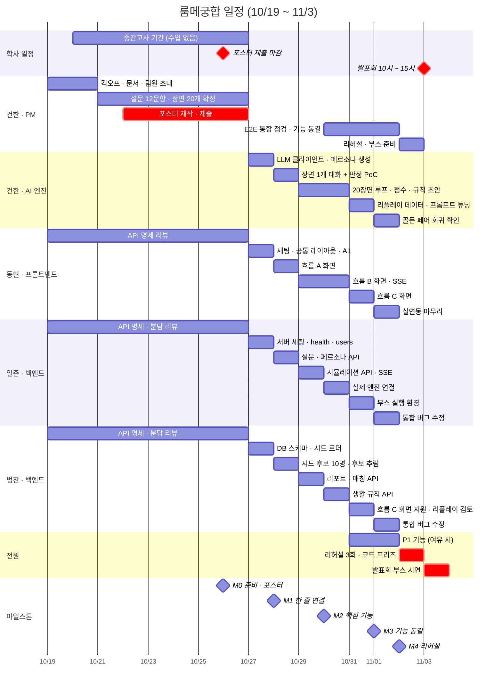

# 룸메궁합 일정 · 간트 차트

| 항목 | 내용 |
| --- | --- |
| 기간 | 2026-10-19(월) ~ 11-03(화) |
| 개발 | **10/27(화) ~ 11/1(일), 6일** |
| 관리 | 작업마다 GitHub 이슈([#1] ~ [#29]), [마일스톤](https://github.com/gokimkh123/SW_Design_Development/milestones) M0 ~ M4 |
| 함께 보는 문서 | [PRD](PRD.md) · [API 명세서](API.md) · [협업 가이드](../CONTRIBUTING.md) |

## 핵심 날짜

| 날짜 | 내용 |
| --- | --- |
| 10/19(월) | 킥오프 · 역할 확정 · 문서 공유 |
| 10/20(화) ~ 10/26(월) | 중간고사 기간 (수업 없음). 개발 없이 문서 · 콘텐츠 · 포스터만 |
| **10/26(월) 23:59** | 발표 포스터 제출 (PPTX, 팀 대표 1명) |
| **10/27(화)** | 개발 시작 |
| **11/1(일)** | 기능 동결 |
| 11/2(월) | 리허설 3회 · 코드 프리즈 |
| **11/3(화) 10:00 ~ 15:00** | AI·SW 신기술 전공 프로젝트 발표회 |

## 간트 차트

빨간 막대는 날짜를 넘기면 안 되는 일(포스터 제출, 리허설, 발표회)이다.

## 마일스톤

| 마일스톤 | 날짜 | 완료 기준 | 이슈 |
| --- | --- | --- | --- |
| M0 준비 · 포스터 | 10/26(월) | 설문 12문항 · 장면 20개 확정, API 명세 리뷰 완료, 포스터 제출 | [#1] ~ [#5] |
| M1 한 줄 연결 · 엔진 PoC | 10/28(수) | 화면 → API → 가짜 엔진 → DB 한 줄 연결. 엔진이 장면 1개 대화 + 판정 JSON 출력 | [#6] ~ [#13] |
| M2 핵심 기능 | 10/30(금) | 흐름 A 실연동, 엔진 20장면 완주, 흐름 B 화면에서 SSE 수신 | [#14] ~ [#19] |
| M3 기능 동결 | 11/1(일) | 흐름 A → B → C 한 번에 연결. 이후에는 버그 수정만 | [#20] ~ [#26] |
| M4 리허설 · 발표회 | 11/2(월) ~ 11/3(화) | 리허설 3회 연속 성공, 11/3 부스 시연 | [#27] ~ [#29] |

## 날짜별 · 사람별 할 일

| 날짜 | 건한 (PM · AI 엔진) | 동현 (프론트엔드) | 일준 (백엔드) | 범찬 (백엔드) |
| --- | --- | --- | --- | --- |
| 10/19(월) | 킥오프 · 문서 공유 · 팀원 초대 [#1] | API 명세 읽기 [#5] | API 명세 읽기 [#5] | API 명세 읽기 [#5] |
| 10/20 ~ 10/26 (중간고사) | 설문 확정 [#2] · 장면 확정 [#3] · **포스터 제출 [#4]** | API 명세 · 기술 스택 리뷰 [#5] | API 명세 · 백엔드 분담 리뷰 [#5] | API 명세 · 백엔드 분담 리뷰 [#5] |
| 10/27(화) | LLM 클라이언트 · 페르소나 생성 [#12] | 세팅 · 공통 레이아웃 · A1 [#6] | 서버 세팅 · health · users [#8] | DB 스키마 · 시드 로더 [#10] |
| 10/28(수) **M1** | 장면 1개 대화 + 판정 PoC [#13] | 흐름 A 화면 [#7] | 설문 · 페르소나 API [#9] | 시드 후보 10명 · 후보 추림 [#11] |
| 10/29(목) | 20장면 루프 [#19] | 흐름 B 화면 (mock) [#14] | 시뮬레이션 API · SSE [#15] | 리포트 · 매칭 API [#17] |
| 10/30(금) **M2** | 점수 · 규칙 초안 [#19], 엔진 연결 페어 [#16] | 흐름 B 실연동 [#14] | 실제 엔진 연결 [#16] | 생활 규칙 API [#18] |
| 10/31(토) | 리플레이 데이터 · 튜닝 [#24] | 흐름 C 화면 [#20] | 부스 실행 환경 [#23] | 흐름 C 화면 지원 [#20] · 리플레이 검토 [#24] |
| 11/1(일) **M3** | 골든 페어 확인 [#25] · 기능 동결 선언 [#26] | 실연동 마무리 [#21] | 통합 버그 수정 [#26] | 통합 버그 수정 [#26] |
| 11/2(월) **M4** | 리허설 진행 [#27] · 부스 준비 [#28] | 리허설 [#27] | 리허설 [#27] | 리허설 [#27] |
| 11/3(화) | 발표회 [#29] | 발표회 [#29] | 발표회 [#29] | 발표회 [#29] |

- 10/30 ~ 11/1 매일 저녁 전원이 방문객 흐름을 한 번씩 돌려 본다 [#26].
- P1 기능 [#22]은 P0를 끝낸 사람부터 10/31 ~ 11/1에 진행하고, 11/1까지 못 끝낸 것은 최종 개발로 넘긴다.

## 진행 상황 보는 법

- **마일스톤 페이지**: [Milestones](https://github.com/gokimkh123/SW_Design_Development/milestones)에서 M0 ~ M4 진행률을 본다.
- **내 할 일**: Issues에서 `assignee:@me` 또는 라벨 `area:frontend` · `area:backend` · `area:engine`으로 거른다.
- **매일 스탠드업**: 오늘 닫을 이슈 번호를 말한다.

[#1]: https://github.com/gokimkh123/SW_Design_Development/issues/1
[#2]: https://github.com/gokimkh123/SW_Design_Development/issues/2
[#3]: https://github.com/gokimkh123/SW_Design_Development/issues/3
[#4]: https://github.com/gokimkh123/SW_Design_Development/issues/4
[#5]: https://github.com/gokimkh123/SW_Design_Development/issues/5
[#6]: https://github.com/gokimkh123/SW_Design_Development/issues/6
[#7]: https://github.com/gokimkh123/SW_Design_Development/issues/7
[#8]: https://github.com/gokimkh123/SW_Design_Development/issues/8
[#9]: https://github.com/gokimkh123/SW_Design_Development/issues/9
[#10]: https://github.com/gokimkh123/SW_Design_Development/issues/10
[#11]: https://github.com/gokimkh123/SW_Design_Development/issues/11
[#12]: https://github.com/gokimkh123/SW_Design_Development/issues/12
[#13]: https://github.com/gokimkh123/SW_Design_Development/issues/13
[#14]: https://github.com/gokimkh123/SW_Design_Development/issues/14
[#15]: https://github.com/gokimkh123/SW_Design_Development/issues/15
[#16]: https://github.com/gokimkh123/SW_Design_Development/issues/16
[#17]: https://github.com/gokimkh123/SW_Design_Development/issues/17
[#18]: https://github.com/gokimkh123/SW_Design_Development/issues/18
[#19]: https://github.com/gokimkh123/SW_Design_Development/issues/19
[#20]: https://github.com/gokimkh123/SW_Design_Development/issues/20
[#21]: https://github.com/gokimkh123/SW_Design_Development/issues/21
[#22]: https://github.com/gokimkh123/SW_Design_Development/issues/22
[#23]: https://github.com/gokimkh123/SW_Design_Development/issues/23
[#24]: https://github.com/gokimkh123/SW_Design_Development/issues/24
[#25]: https://github.com/gokimkh123/SW_Design_Development/issues/25
[#26]: https://github.com/gokimkh123/SW_Design_Development/issues/26
[#27]: https://github.com/gokimkh123/SW_Design_Development/issues/27
[#28]: https://github.com/gokimkh123/SW_Design_Development/issues/28
[#29]: https://github.com/gokimkh123/SW_Design_Development/issues/29
