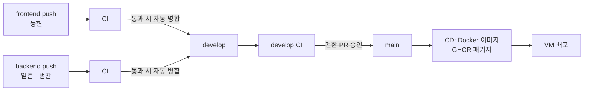

# 협업 가이드

- 룸메궁합 팀의 GitHub 협업 규칙
- 개발 착수 **10/27(화)**, 기능 동결 **11/1(일)**

## 팀과 담당

| 이름 | 역할 | 담당 폴더 | 주요 참고 문서 |
| --- | --- | --- | --- |
| 건한 | PM · 기획 · QA, AI 시뮬레이션 엔진 | `docs/` `engine/` `data/` | [PRD](PRD.md) · [일정](SCHEDULE.md) |
| 동현 | 프론트엔드 | `frontend/` | [API 명세서](API.md) 1~5장 |
| 일준 | 백엔드 | `backend/` | [API 명세서](API.md) 전체 |
| 범찬 | 백엔드 · 데이터 | `backend/` `data/seed/` | [API 명세서](API.md) 전체 |

## 작업 흐름



| 브랜치 | 담당 | 역할 | 다음 단계 | 자동화 |
| --- | --- | --- | --- | --- |
| `frontend` | 동현 | 프론트엔드 작업 | CI 통과 시 `develop` **자동 병합** | push마다 CI |
| `backend` | 일준 · 범찬 | 백엔드 작업 | CI 통과 시 `develop` **자동 병합** | push마다 CI |
| `develop` | 건한 | 통합 · 검증 | 건한이 `develop` → `main` PR 병합 | 자동 병합 직후 CI |
| `main` | 건한 | 배포 · 발표회 버전 | — | CD (Docker 이미지 → VM 배포) |

1. **할 일 확인** — [일정 문서](SCHEDULE.md)의 날짜별 할 일 표 내 당일 담당 칸 확인
2. **최신화** — 작업 전 담당 브랜치에서 `git pull` 후 `git pull origin develop`으로 다른 영역 변경 반영
3. **커밋 · push** — 아래 커밋 규칙 준수, 작은 단위로 수시 커밋 후 담당 브랜치(`frontend` · `backend`)에 push
4. **CI 확인** — 저장소 **Actions** 탭에서 결과 확인. 통과 시 `develop` 자동 병합, 실패 시 같은 브랜치에 수정 커밋 push
5. **자동 병합 실패 처리** — `auto merge to develop` 빨간 표시 시 로그 확인
   - 충돌: `git pull origin develop` → 충돌 해결 → push
   - 보호 경로 변경: 아래 보호 경로 규칙에 따라 PR로 반영
6. **`main` 반영 · 배포** — 건한이 `develop` CI 통과 확인 후 `develop` → `main` PR 병합 → CD 자동 실행
7. **`develop` 상시 실행 가능 상태 유지** — CI 실패 코드는 자동 병합되지 않음. 자동 병합 후 `develop` CI 실패 시 원인 브랜치 담당자가 수정 push, 발표회 버전은 `main`에서 실행

- 팀원은 `develop` · `main`에 직접 push 금지 (아래 브랜치 보호 참고)
- 문서 · 엔진 · 데이터(건한): 단기 브랜치(`docs/…` 등) → `develop` PR 병합
- 코드 리뷰: 자동 병합 체계로 PR 승인 절차 생략. 리뷰 짝은 `develop` 반영 후 내용을 확인하고 문제 시 담당자에게 공유

### 보호 경로 규칙

- 대상: `.github/` · `.githooks/` · `scripts/` · `deploy/` · `docs/common/` · `.gitignore` · `.gitattributes` · `.dockerignore` · `Dockerfile`
- 위 경로 변경이 포함된 push는 CI 통과 후에도 자동 병합 중단 (CI/CD · 보안 설정 및 공통 문서 무단 변경 방지)
- 반영 방법: 해당 변경만 단기 브랜치(`chore/…` · `docs/…`)로 분리 → `develop` 대상 PR 생성 → 건한 승인 후 병합
- 병합 방식: 단기 브랜치 PR은 **Squash and merge**, `frontend` · `backend` 출발 PR은 **Create a merge commit** (장기 브랜치 이력 보존)
- `frontend` · `backend` 브랜치에 이미 보호 경로 변경을 커밋한 경우: 해당 브랜치 → `develop` PR 생성, 건한 승인 · 병합 전까지 자동 병합 중단 상태 유지

### 브랜치 보호 (10/28 설정)

| 브랜치 | 설정 | 효과 |
| --- | --- | --- |
| `main` | PR 필수, 필수 체크 `source branch is develop` · `secret scan`, 강제 push · 삭제 금지, Ruleset으로 갱신 권한 건한 한정 | 직접 push 불가, `develop` 출발 · 비밀 정보 검사 통과 PR을 건한만 병합 |
| `develop` | 강제 push · 삭제 금지 | PR · 체크 필수 미적용 (적용 시 자동 병합 불가) |
| `frontend` · `backend` | 강제 push · 삭제 금지 | 병합 후 자동 삭제 대상에서 제외, 이력 보존 (`git push --force` 대신 `git pull` 후 push) |

- 저장소 설정 "Automatically delete head branches" 사용: PR 병합 시 단기 브랜치 자동 삭제
- `develop` 직접 push는 기술적으로 차단되지 않으므로 규칙으로 금지 (건한의 `develop` → `main` PR 검토 시 확인)

## CI/CD

| 워크플로 | 실행 시점 | 내용 |
| --- | --- | --- |
| [CI](../../.github/workflows/ci.yml) | `main` 외 브랜치 push, `develop` 대상 PR | 비밀 정보 검사 / 프론트엔드: `npm ci` → 타입 검사 → 테스트 → 빌드 / 백엔드: `pytest` (가짜 엔진) / Docker 이미지 빌드 검증 |
| [auto merge to develop](../../.github/workflows/auto-merge.yml) | `frontend` · `backend`의 CI 통과 | 해당 커밋을 `develop`에 병합 → `develop` CI 실행 |
| [main guard](../../.github/workflows/main-guard.yml) | `main` 대상 PR | 출발 브랜치가 `develop`이 아니면 실패, 비밀 정보 검사 |
| [CD](../../.github/workflows/cd.yml) | `main` push | Docker 이미지 빌드 → GHCR 패키지 업로드 → VM에서 `docker compose` 재기동 ([VM 배포 안내](DEPLOY.md)) |

- push 전 로컬 확인 권장: `frontend/`에서 `npm run typecheck && npm test`, `backend/`에서 `python -m pytest`
- API 키: CI는 가짜 엔진(`ENGINE_IMPL=fake`)으로 키 미사용, 배포 키는 VM의 `~/roommate/.env`에만 보관
- 백엔드 배포 조건: `backend/app/main.py`(FastAPI `app`) 및 `backend/requirements.txt` 존재 시 자동 포함, 그 전에는 프론트엔드 목업 모드만 배포

## 브랜치 이름

| 접두사 | 용도 | 예 |
| --- | --- | --- |
| `feat/` | 기능 | `feat/simulation-sse` |
| `fix/` | 버그 수정 | `fix/report-score-null` |
| `docs/` | 문서 | `docs/api-review` |
| `chore/` | 설정 · 빌드 · 데이터 | `chore/seed-personas` |

- 장기 브랜치 `frontend` · `backend` 외 단기 브랜치(건한의 문서 · 엔진 · 데이터 작업, 보호 경로 변경 PR)에만 적용
- 팀원의 일반 기능 · 버그 수정은 단기 브랜치 없이 담당 브랜치(`frontend` · `backend`)에 직접 커밋

## 커밋 메시지

```text
<종류>[(<영역>)]: <한국어 설명>
```

- 종류: `feat` 기능 · `fix` 버그 · `docs` 문서 · `refactor` 구조 개선 · `test` 테스트 · `chore` 설정·데이터
- 영역은 선택 사항: `frontend` · `backend` · `engine` · `data` · `docs`
- **콜론 뒤 설명은 한국어로 작성한다.** `feat`·`docs` 같은 종류와 선택적 영역만 영문으로 쓴다.
- 예: `docs: 문서 수정`, `feat(frontend): 페르소나 카드 화면 추가`, `fix(backend): 리포트 점수 null 처리`

## 리뷰 짝

| 영역 | 리뷰어 | 리뷰 시점 | 사유 |
| --- | --- | --- | --- |
| `frontend/` | 범찬 | `develop` 자동 병합 후 | 흐름 C 화면 공동 담당, API 연동 확인 |
| `backend/` | 일준 ↔ 범찬 상호 | `develop` 자동 병합 후 | 동일 서버 코드 |
| `engine/` | 범찬 | PR 병합 전 | 엔진 연결 담당 |
| `docs/common/API.md` | 동현 + 백엔드 1명 | PR 병합 전 | 프론트 · 백엔드 간 약속 변경 |
| 보호 경로 · `docs/common/` | 건한 | PR 병합 전 | PM · CI/CD · 보안 설정 |

- 리뷰 · PR 승인은 요청 당일 내 처리 (6일 개발 기간 고려, 1일 이상 정체 방지)

## API 변경 절차

1. `docs/common/API.md` 수정을 단기 브랜치(`docs/…`)로 분리하여 `develop` 대상 PR 생성 (보호 경로이므로 `frontend` · `backend` push로는 자동 병합 불가)
2. 동현 및 백엔드 1명 승인 후 건한이 병합
3. 코드 변경 진행

## 문서 문체

- 브랜치 작업 중에는 자유롭게 작성
- `develop` → `main` 병합 전 문어체(`~한다`) 또는 개조식(명사형 종결)으로 정리, 구어체(`~해요` · `~합니다`) 금지
- 예외: 앱 화면 노출 문구(설문 문항, 한 줄 판정 등)

## 버그 처리

- 즉시 수정 가능 시 담당 브랜치(`frontend` · `backend`)에 수정 커밋 push
- 담당자 확인 필요 시 GitHub 이슈 버그 템플릿 등록 또는 단톡방에 재현 방법과 함께 공유

## 소통

- **스탠드업** — 10/27 ~ 11/2 매일 10분 (시간은 팀 협의): 전일 작업 · 당일 작업 · 애로 사항
- **애로 사항 30분 내 공유** — 장시간 단독 지체 방지
- 결정 사항은 PR 댓글 또는 문서에 기록

## 비밀 정보 관리

> **위험도 1순위.** 본 저장소는 공개(public) 저장소이며 GitHub Actions 로그도 누구나 열람 가능. 비밀 정보 유출은 다른 모든 일정 · 기능보다 우선하여 차단한다.

| 보호 대상 | 보관 위치 | 유출 시 영향 |
| --- | --- | --- |
| Anthropic API 키 | VM `~/roommate/.env` (GitHub · 저장소 · 이미지 미포함) | 과금 도용 |
| VM 접속 키 (플랫폼 발급) | 건한 PC, GitHub Environment `production` Secret | VM 장악 (sudo 권한) |

- 원칙: API 키는 팀원에게 배포하지 않음. 로컬 개발은 `ENGINE_IMPL=fake`(가짜 엔진)로 키 없이 진행, 실제 키는 VM `~/roommate/.env`에만 보관
- 실제 엔진 테스트 필요 시 건한이 사용 한도를 건 개인별 키 발급, 작업 종료 후 폐기
- `.env` 커밋 금지, [`backend/.env.example`](../../backend/.env.example) 복사 후 사용. PR · 커밋 · 단톡 공지 내 키 기재 금지

| 차단 장치 | 단계 | 동작 |
| --- | --- | --- |
| `.gitignore` | `git add` | `.env` · 키 · 인증서 파일 추적 제외 |
| pre-commit hook ([`.githooks/pre-commit`](../../.githooks/pre-commit)) | 커밋 | `.env` 파일 · API 키 · 토큰 · 개인키 문자열 포함 시 커밋 거부 |
| GitHub Push protection | push | 알려진 형식의 키가 포함된 push 거부 |
| CI `secret scan` ([`scripts/check-secrets.sh`](../../scripts/check-secrets.sh)) | push · PR | 검사 실패 시 `develop` 자동 병합 중단, `main` 대상 PR 실패 표시 |
| 보호 경로 규칙 ([`auto-merge.yml`](../../.github/workflows/auto-merge.yml)) | 자동 병합 | CI/CD · 보안 · 배포 설정 변경은 자동 병합 중단 → PR로 건한 승인 |
| Environment `production` | 배포 | VM 접속 정보는 `main` 배포 job에서만 접근 가능 (배포 브랜치 `main` 한정) |
| Ruleset `main 갱신은 관리자(건한)만` | `main` 반영 | 팀원의 `main` 병합 · push 차단 → 배포 워크플로 변경은 건한 검토 후에만 실행 |
| 외부 기여자 PR 승인 | fork PR | 외부인 PR의 CI는 건한 승인 후 실행 (Secrets 미전달) |
| CODEOWNERS | PR | 보호 경로 · API 명세 PR 생성 시 담당 리뷰어 자동 지정 |

- pre-commit hook 활성화(최초 1회, 저장소 루트): `git config core.hooksPath .githooks` (`frontend/`에서 `npm install` 시 자동 설정)
- 검사 우회(`--no-verify` 등) 금지. 오탐 시 건한에게 문의
- 워크플로에서 Secret 값 출력 · 변환 출력(base64 등) 금지: 공개 로그로 즉시 유출
- 키 노출 시 즉시 건한에게 보고 → 키 폐기 · 재발급 (커밋 삭제만으로는 불충분)
  - API 키: Anthropic Console에서 폐기 · 재발급 → VM `.env` 교체 → `docker compose up -d backend`
  - VM 접속 키: Leorca 콘솔 "키 재발급" → GitHub `production`의 `VM_SSH_KEY` 교체

## 문서 위치

- `docs/frontend/`: 프론트엔드 문서 · `docs/backend/`: 백엔드 문서 · `docs/common/`: 공통 문서 ([문서 목록](README.md))
- 새 문서는 세 폴더 중 해당 영역에 작성, `docs/` 바로 아래 파일 · 폴더 추가 금지
