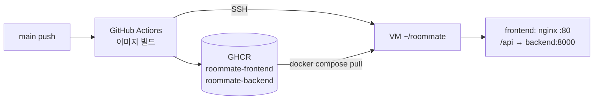

# VM 배포 (Docker)

- `main` 반영 시 [CD 워크플로](../../.github/workflows/cd.yml)가 Docker 이미지를 빌드하여 GHCR에 업로드하고, VM에서 `docker compose`로 재기동한다.
- API 키는 VM의 `~/roommate/.env`에만 둔다. GitHub · 이미지 · 저장소에는 포함하지 않는다.

## 현재 운영 환경 (10/31)

| 항목 | 내용 |
| --- | --- |
| 플랫폼 | 레오르카 클러스터(Leorca) VM, Ubuntu 24.04, 2 vCPU · 4GB |
| 웹 주소 | <https://roommate-chan-21.apps.dauai.org> (Leorca 콘솔 VM 상세 → 웹 → 포트 `80` 공개) |
| 런타임 | Docker 29.9, Compose v5.6 (10/29 설치) |
| SSH | 플랫폼 SSH 게이트웨이 경유. 접속 정보는 GitHub Environment `production` Secrets에만 등록, 공개 문서 기재 금지 |

## 구성



| 이미지 | 내용 | 빌드 조건 |
| --- | --- | --- |
| `ghcr.io/gokimkh123/roommate-frontend` | Vite 빌드 결과 + nginx, `/api` 요청을 `backend:8000`으로 프록시 (SSE 버퍼링 해제) | 항상 |
| `ghcr.io/gokimkh123/roommate-backend` | Python 3.12 + `uvicorn app.main:app` (포트 8000), `engine/` · `data/` 포함 | `backend/app/main.py`와 `backend/requirements.txt` 모두 존재 시 |

- 백엔드 서버 코드 준비 전: 프론트엔드만 **목업 모드**(`VITE_USE_MOCK=true`)로 배포
- 백엔드 서버 코드 병합 후: 프론트엔드 실서버 모드 + 백엔드 함께 배포 (별도 설정 불필요)
- 태그: `latest`, 커밋 SHA (롤백 방법은 아래 롤백 절 참고)

## 백엔드 서버 코드 조건

- 진입점: `backend/app/main.py`의 FastAPI 인스턴스 `app`
- 의존성: `backend/requirements.txt` (`fastapi`, `uvicorn` 등 런타임 패키지)
- 컨테이너 내 경로: `/srv/backend`(작업 폴더), `/srv/engine`, `/srv/data` → 저장소와 동일한 상대 경로 유지
- DB: `DATABASE_URL=sqlite:////srv/var/roommate.db` (compose에서 지정, 볼륨 `backend-db`에 보존)

## VM 최초 준비 (1회, 건한)

1. Docker Engine 및 Compose 플러그인 v2.24 이상 설치 (`docker compose version`으로 확인, `env_file`의 `required: false` 지원 버전)
2. 배포 계정을 `docker` 그룹에 추가: `sudo usermod -aG docker <계정>` 후 재접속
3. 배포용 SSH 키 준비: Leorca는 게이트웨이가 플랫폼 발급 키로 인증하므로 발급 키를 그대로 사용 (별도 키 생성 · `authorized_keys` 수정 불필요, 키 재발급 시 `VM_SSH_KEY` 교체)
4. (일반 VM인 경우) 배포 전용 키 생성 `ssh-keygen -t ed25519 -f ~/.ssh/roommate_deploy -N ""` 후 공개키를 VM `~/.ssh/authorized_keys`에 추가
5. VM에 `~/roommate/.env` 작성 (커밋 금지)

```bash
mkdir -p ~/roommate && cd ~/roommate
cat > .env <<'ENV'
WEB_PORT=80
ANTHROPIC_API_KEY=<API 키>
LLM_PROVIDER=anthropic
LLM_MODEL=claude-haiku-5-5
LLM_MAX_CONCURRENCY=8
# 엔진 패키지(engine/__init__.py · engine/models.py) main 반영 전까지 fake 유지, 반영 후 real로 변경
ENGINE_IMPL=fake
SIM_MODE=agents
REPLAY_DELAY_MS=600
ENV
chmod 600 .env
```

- `ENGINE_IMPL=real`을 엔진 패키지 반영 전에 설정하면 `engine.models` import 실패로 백엔드 오류 발생
- `.env` 변경 후 반영: `docker compose up -d backend`

6. 방화벽에서 `WEB_PORT`(기본 80) 및 SSH 포트 허용
7. GitHub 저장소 **Settings → Environments → `production`** 확인
   - **Deployment branches and tags**: `Selected branches and tags` → `main`만 등록 (10/28 설정 완료, 변경 금지: 해제 시 다른 브랜치 워크플로에서 Secrets 접근 가능)
8. 같은 화면 **Environment secrets → Add secret**으로 아래 값 등록 (Repository secret 사용 금지: 모든 브랜치 워크플로에서 접근 가능)

| Secret | 값 | 필수 |
| --- | --- | --- |
| `VM_HOST` | VM 공인 IP 또는 도메인 | 필수 |
| `VM_USER` | 배포 계정 이름 | 필수 |
| `VM_SSH_KEY` | 개인키(`roommate_deploy`) 파일 전체 내용 | 필수 |
| `VM_SSH_PORT` | SSH 포트 | 선택 (기본 22) |

- Secrets 미등록 시 CD는 이미지 업로드까지만 수행하고 배포 단계 생략 (경고 표시)
- 등록 후 **Actions → CD → Run workflow**(브랜치 `main` 선택)로 수동 배포 가능. 다른 브랜치 선택 시 빌드 · 배포 생략
- VM이 외부(GitHub Actions)에서 SSH 접속 불가한 사설망인 경우: self-hosted runner 방식으로 전환 필요

## 운영 명령 (VM)

- 서비스 이름 명시: 백엔드 배포 전에는 `frontend`만, 배포 후에는 `frontend backend` (백엔드 이미지가 없는 상태에서 서비스 이름 없이 `pull` · `up` 실행 시 실패)

| 목적 | 명령 (`~/roommate`에서) |
| --- | --- |
| 상태 확인 | `docker compose ps` |
| 로그 확인 | `docker compose logs -f frontend` (백엔드: `backend`) |
| 재시작 | `docker compose restart` |
| 설정 반영 | `docker compose up -d frontend` (백엔드 배포 후: `frontend backend`) |
| 중지 | `docker compose down` (DB 볼륨 유지) |

## 롤백

- 방법: GitHub **Actions → CD** → 되돌릴 시점의 성공 실행 선택 → **Re-run all jobs**
- 동작: 해당 시점 커밋으로 이미지 재빌드 → `latest` 갱신 → VM 재배포 (VM 로그인 · 파일 수정 불필요)
- 이후 `main`에 새 커밋 반영 시 다시 최신 버전으로 배포되므로, 문제 코드는 담당 브랜치에서 수정 후 재반영
